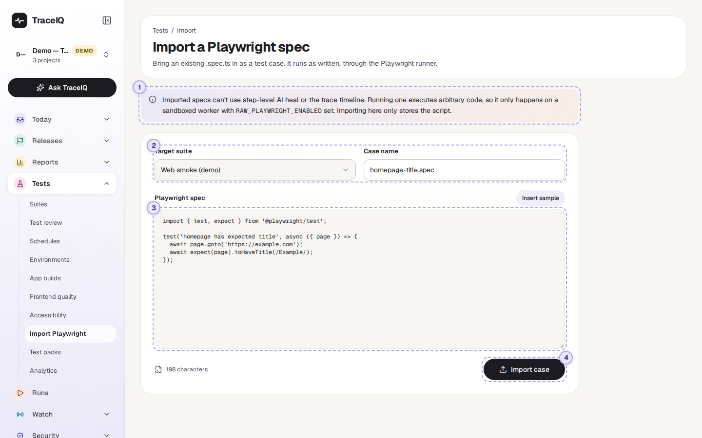
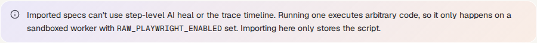
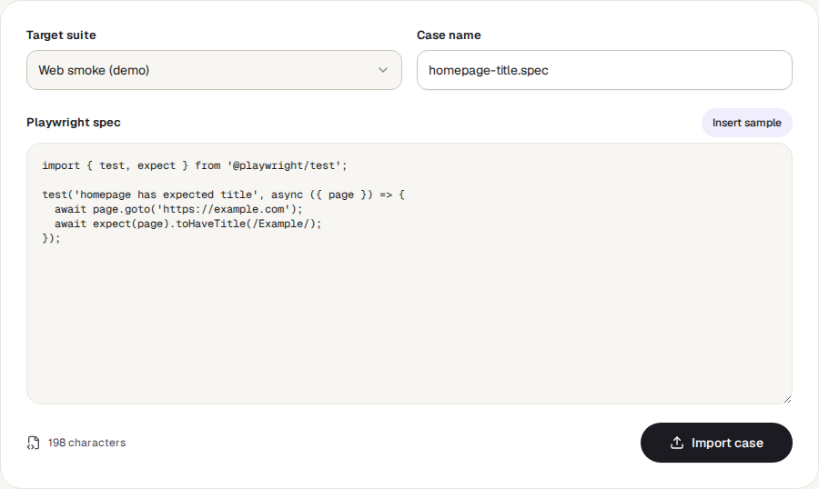

<!-- Generated from import-playwright.html by e2e/docs-capture/export_md.py. Edit the HTML, not this file. -->

# Import Playwright

Tests · Everyone with access to a project can open it · Editors can import

> **In short**
>
> Many development teams already have browser tests written as code with Playwright. This page copies one such file into a suite as a TraceIQ test, so it runs and reports alongside the others, exactly as written.

## What it is for

**Playwright** is the browser-automation tool TraceIQ itself is built on; its tests are files ending in `.spec.ts`. Rewriting existing ones as TraceIQ steps takes time. Importing answers **"Can I use the tests we already have, today?"**: the code is stored as one test and run as it is, with its results on the Runs page.

> **Developers**
>
> Bring a test from the code repository without rewriting it.

> **Testers**
>
> Keep every test's results in one place, whoever wrote it and however.

> **Administrators**
>
> Decide whether code tests may run at all, on a separate, locked-down test machine.

**Where to find it:** in the sidebar, open **Tests → Import Playwright**. The page's own heading says **Import a Playwright spec**. The list of suites comes from the project selected at the top of the sidebar.

## A tour of the screen

One note and one form. In the screenshot the form has been filled in with the built-in sample; nothing was imported. The numbers match the sections below.

*The Import Playwright page, filled in with the sample. Click the picture to see it larger.*

## 1. The note

In plain words:

- TraceIQ runs the file as a whole and doesn't look inside it, so features that work step by step are not available for it: automatic repair of broken selectors ("AI heal") and the step-by-step trace view.
- The file is program code and could do anything, so it only runs on a test machine your administrator has set up specially for it (closed off from everything else, with the `RAW_PLAYWRIGHT_ENABLED` setting). On any other machine, the run ends in *Error* with the message "raw_playwright execution is disabled on this worker".
- Importing only stores the file. It doesn't run it.

## 2. Suite and name

**Target suite**: the suite the new test goes into, from the selected project. Suites that contain sub-modules can't hold tests directly, so TraceIQ refuses those. **Case name**: the name the test will have in the suite, for example *checkout-flow.spec*.

## 3. The spec

Paste the whole contents of the `.spec.ts` file. **Insert sample** fills in a tiny example (open example.com and check the page title), useful to see the expected shape. The character count under the box shows how much you pasted. The file may contain several Playwright tests; each one's result is reported separately in the run.

## 4. Import case

Becomes available once a suite, a name and some code are there. It creates the test and takes you to the suite. The new test shows *0 steps* there, because its contents are code rather than steps.

## Watch it in use

[▶ Watch the video](../media/tests/import-playwright/walkthrough.mp4)

*Under 40 seconds, with a spoken commentary. The captions at the bottom show the same words, so it also works with the sound off.*

## How to…

### …import a test from your code repository

1. Check with your administrator that a test machine for code tests exists; otherwise the test will be stored but every run of it ends in *Error*.
2. Choose the **Target suite** and type a **Case name**.
3. Open the `.spec.ts` file, copy everything, and paste it into **Playwright spec**.
4. Press **Import case**. On the suite page, run it with **Run now**.

### …update a code test

1. Import the new version of the file into the same suite, under a new name.
2. Run it once to check it works.
3. Delete the old test from the suite (its schedules, if any, have to be moved to the new test first).

## Good to know

- **Who can do what.** Anyone can open the page, but importing needs the *editor* role in the suite's project.
- **The code can't be seen or edited in TraceIQ afterwards.** To change it, import the new version as a new test and delete the old one. Keep the original file in your code repository.
- **`{{env.…}}` and `{{secret.…}}` don't work inside the code.** TraceIQ doesn't read the file, so it can't fill in placeholders.
- **The page keeps nothing.** If you leave before pressing Import case, what you typed is gone.
- **Time limit.** A code test is stopped after the same time limit as any other test job.

## Related pages

> **Test packs**
>
> The next page in this guide: ready-made suites for common integrations.

> **Suites**
>
> Where imported tests appear, and where tests made of steps are written.

> **Schedules**
>
> Run an imported test automatically, like any other test.

> **Runs**
>
> The results of every imported test.

## Video script

What the walkthrough says, in order. The video and every picture on this page are made by the Playwright script [`tests-import-playwright.spec.ts`](../../../../e2e/docs-capture/pages/tests-import-playwright.spec.ts).

1. Import Playwright brings in a test that a developer has already written as Playwright code.
2. The note explains that such a test runs exactly as written, on a specially prepared test machine.
3. First choose the suite it goes into, and give it a name.
4. Then paste the code. Insert sample shows what a small one looks like.
5. Import case stores it as a new test in that suite. It does not run it.
6. Nothing is saved here until you press Import case.
