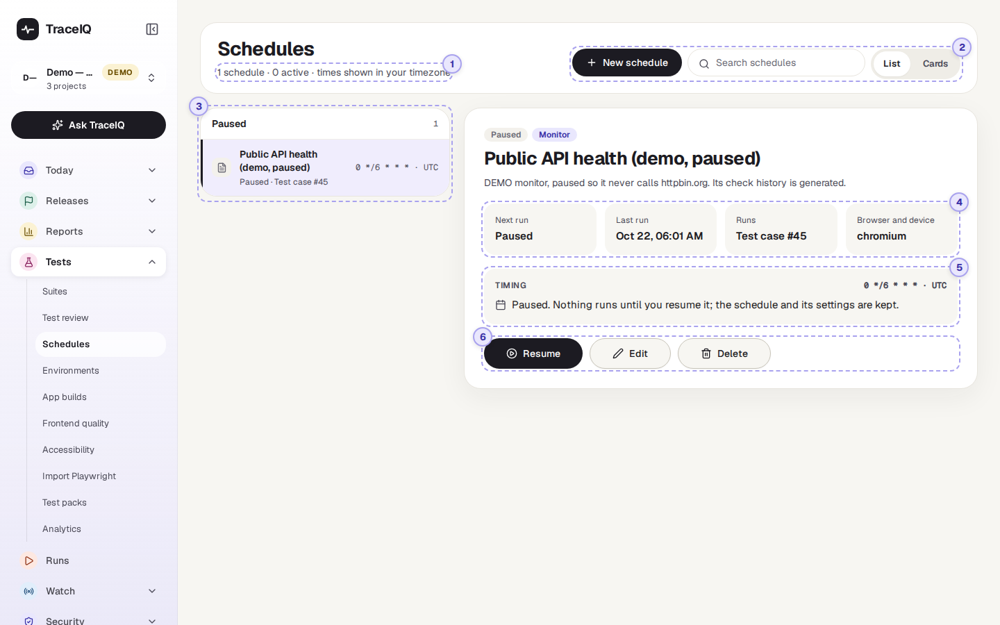
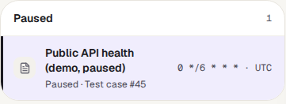
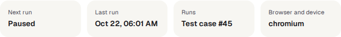
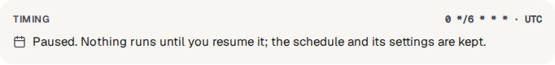
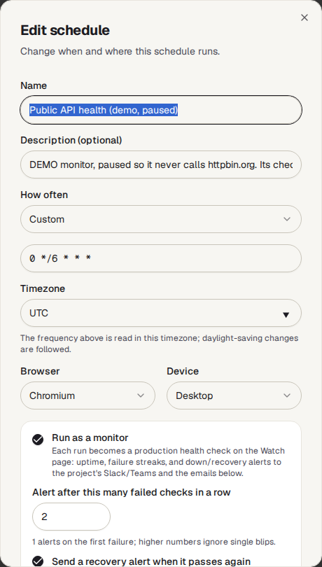

<!-- Generated from schedules.html by e2e/docs-capture/export_md.py. Edit the HTML, not this file. -->

# Schedules

Tests · Everyone with access to the project can see it · Project admins can change it

> **In short**
>
> A schedule runs a suite, or a single test, by itself at set times, for example every night at 2 a.m. This page lists the project's schedules, shows when each one runs next, and lets you pause, change or delete them.

## What it is for

Tests are most useful when they run often, not only when someone remembers. A schedule answers **"Is the site still working, even when nobody is looking?"**: the results of every scheduled run land on the *Runs* page like any other run, and the usual emails or chat messages go out.

> **Testers**
>
> Run the full regression suite every night, and start the day with the results.

> **Developers**
>
> Know that a problem introduced today will show up by tomorrow morning.

> **Leads**
>
> See at a glance what runs automatically, how often, and what has been paused.

**Where to find it:** in the sidebar, open **Tests → Schedules**. It shows the project selected at the top of the sidebar.

## A tour of the screen

The list of schedules is on the left; the one you pick is shown on the right. The numbers on the screenshot match the sections below.

*The Schedules page for the demo's API project, which has one paused schedule. Click the picture to see it larger.*

## 1. The counts line

Under the heading, for example *"1 schedule · 0 active · times shown in your timezone"*: how many schedules the project has, and how many of them are running on their timer. Project admins also get a **New schedule** button on the right, which opens the schedule form with a **Suite to run** picker.

## 2. Search and layout

The search box keeps only schedules whose name, description or timing contains what you type. **List** and **Cards** switch between the list-and-details view and a grid of cards with the same information and buttons. Both only appear once the project has a schedule. A schedule that is a monitor carries a **Monitor** label.

## 3. The list

Schedules are boxed into **Active** and **Paused**. Each row shows the schedule's name, when it runs next (or "Paused"), what it runs, and its timing. The icon is a folder for a whole suite (or sub-module) and a page for a single test, in colour while active and grey while paused. **Click a row** to show it on the right.

## 4. The four facts

| Fact | What it tells you |
|---|---|
| **Next run** | When it will run next, in *your own* time zone. "Paused" while it is paused. |
| **Last run** | When it last started a run, in your own time zone. "Never" for a new schedule. |
| **Runs** | What it runs: *Module #…* for a suite or sub-module, *Test case #…* for a single test. Only the number is shown, not the name. |
| **Browser and device** | The one browser (and device, if not Desktop) every run of this schedule uses. |

## 5. Timing

The timing is a **cron expression**: five values that say at which minute, hour, day of the month, month and day of the week to run. A `*` means "every". A few examples:

| Cron expression | Runs |
|---|---|
| `0 0 * * *` | Every day at midnight (the form's default). |
| `0 * * * *` | Every hour, on the hour. |
| `0 */6 * * *` | Every six hours: 00:00, 06:00, 12:00 and 18:00. |
| `0 9 * * 1` | Every Monday at 9 a.m. |
| `0 2 * * 1-5` | At 2 a.m. on weekdays (Monday to Friday). |

The times are read in the schedule's own **timezone**, shown next to the expression (for example *Asia/Kolkata*), and changes for summer time are followed.

## 6. Pause, Edit, Delete

- **Pause** stops new runs but keeps the schedule and its settings; a run that has already started carries on. On a paused schedule the button says **Resume**.
- **Edit** opens the schedule form (below). Nothing changes until you press *Save changes*.
- **Delete** deletes the schedule, after asking.

These buttons are only shown to project admins.

*The schedule form. It is the same form *Schedule* opens on a suite or a test.*

| Field | What to fill in |
|---|---|
| **Name**, **Description** | How the schedule is listed. New schedules start as "Schedule for *suite name*". |
| **How often** | Every hour, every day at midnight, every Monday at 9 a.m., every Friday at 5 p.m., or *Custom* to type your own cron expression. |
| **Timezone** | The time zone *How often* is read in. New schedules start with your browser's time zone. |
| **Browser**, **Device** | One browser (Chromium, Firefox or WebKit) and one device for every run. |
| **Run as a monitor** | Makes every run a production health check on *Watch → Monitors*. When ticked: **Alert after this many failed checks in a row** (1 = the first failure), **Send a recovery alert when it passes again**, and **Alert emails** (comma-separated). |
| **Regions** | Optional, for organisations with test machines in several places: one run per region each time. Leave empty unless your administrator has set regions up. |

## Watch it in use

[▶ Watch the video](../media/tests/schedules/walkthrough.mp4)

*About a minute, with a spoken commentary. The captions at the bottom show the same words, so it also works with the sound off.*

## How to…

### …run a suite every night

1. Open the suite (**Tests → Suites**), press **More**, then **Schedule this suite**. For one test, press **Schedule** on the test instead.
2. Under **How often**, choose *Custom* and type, for example, `0 2 * * *` for 2 a.m. every day.
3. Check the **Timezone**, pick the browser, and press **Create schedule**.
4. The schedule appears here under **Active**, with its next run.

### …stop a schedule for a while

1. Click it in the list and press **Pause**.
2. When you want it back, press **Resume**. If its time came round while it was paused, it runs once within about a minute, then keeps to its timing again. Missed runs are not all made up.

### …check that last night's run happened

1. Look at **Last run** for the schedule.
2. Open **Runs** in the sidebar to see the result. Scheduled runs are started in the name of the person who created the schedule.

## Good to know

- **Who can do what.** Anyone with access to the project can look. Creating, pausing, editing and deleting schedules needs *project admin* (or workspace admin). Others don't see the buttons.
- **Which time is which.** *Next run* and *Last run* are shown in your browser's time zone; the cron expression is read in the schedule's own time zone.
- **Up to a minute late.** TraceIQ checks for due schedules once a minute, so a run can start up to about a minute after its time.
- **One browser per schedule.** A suite set to run on several browsers in its settings still runs on the one browser and device chosen in the schedule. Make one schedule per browser if you need several. Screen sizes and locales from the suite's settings are still applied.
- **Missed runs aren't repeated.** If TraceIQ was down at the scheduled time, it runs once when it is back and then carries on with the next regular time.
- **Monitors appear here too.** A *monitor* (see *Watch → Monitors*) is a schedule that checks a live site; it is listed here like the demo's "Public API health", with a *Monitor* label, and can be paused here.
- **A schedule protects what it runs.** A suite or test that a schedule uses can't be deleted until the schedule is deleted or changed.
- **It doesn't update by itself.** Reload the page to see a new *Last run*.

## Related pages

> **Environments**
>
> The next page in this guide: where tests run, and the values and secrets they use.

> **Suites**
>
> Where schedules are created, with the Schedule buttons.

> **Monitors**
>
> Schedules that watch a live site and alert when it goes down.

> **Runs**
>
> The results of every scheduled run.

## Video script

What the walkthrough says, in order. The video and every picture on this page are made by the Playwright script [`tests-schedules.spec.ts`](../../../../e2e/docs-capture/pages/tests-schedules.spec.ts).

1. Schedules run tests by themselves, on a timer.
2. The line at the top counts this project’s schedules, and how many are active.
3. Active schedules are listed first. This one is paused.
4. On the right: when it runs next, when it last ran, what it runs, and on which browser.
5. The timing is written as a cron expression. This one means every six hours, on the hour.
6. Pause stops new runs but keeps the settings. Resume starts it again.
7. Edit changes the name, how often, the timezone, the browser and the device.
8. Cancel closes it without saving anything.
9. New schedules are made from a suite or a test, with its Schedule button.
