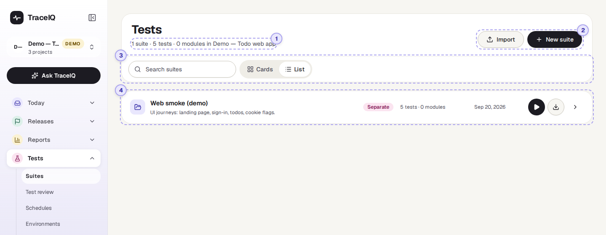
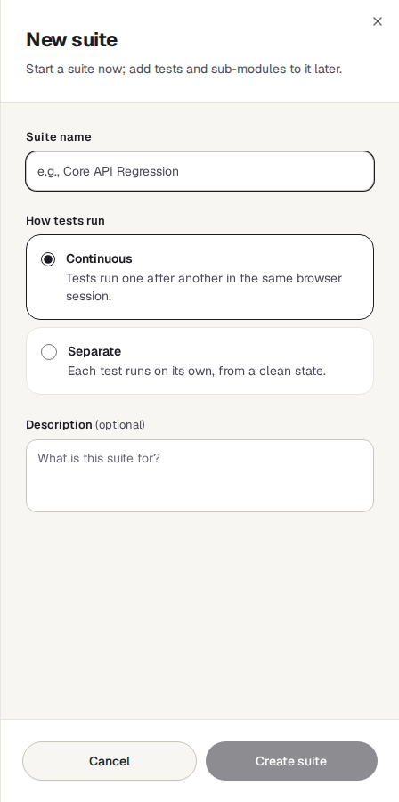
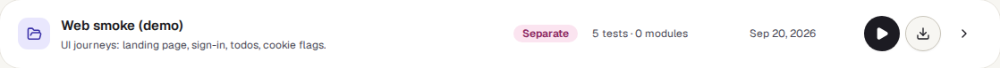
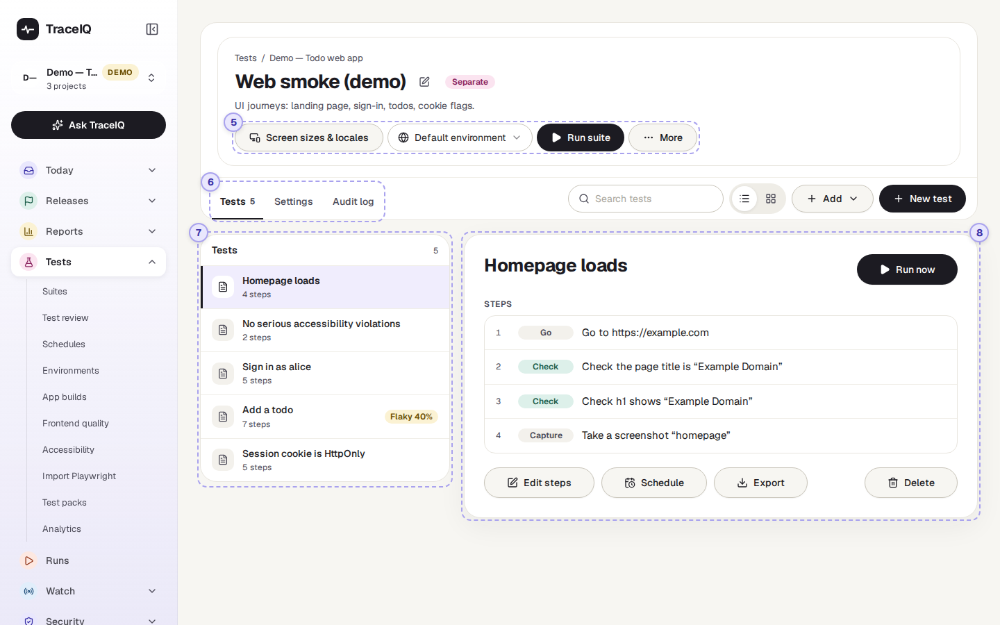
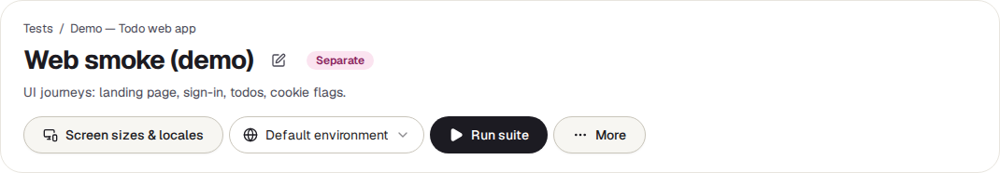
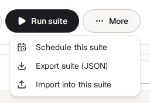
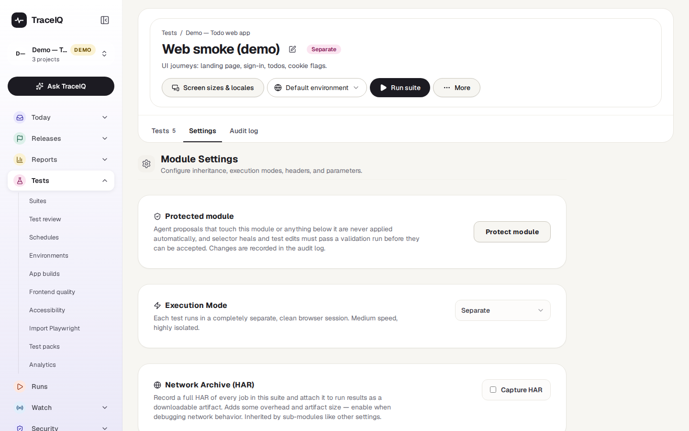
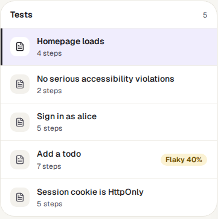
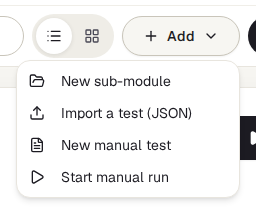

<!-- Generated from suites.html by e2e/docs-capture/export_md.py. Edit the HTML, not this file. -->

# Suites

Tests · Everyone with access to the project can see it · Editors write and run tests · Project admins manage suites

> **In short**
>
> The place where your tests live. Tests are grouped into **suites** (folders of related tests). Open a suite to read its tests in plain words, run them, change their steps or adjust the settings they share.

## What it is for

A **test** is a short list of instructions that TraceIQ carries out in a real browser, such as "open the sign-in page, type a name, press Sign in, check the name appears". A **suite** keeps related tests together, for example everything about signing in, so you can run them in one go and give them the same settings. A large suite can be split into **sub-modules**: suites inside a suite.

> **Testers**
>
> Write and organise tests, run a whole suite before a release, or one test after a fix.

> **Developers**
>
> Read what a test actually does, step by step, and run it against their change.

> **Leads**
>
> See how many tests each area has, and which ones keep failing for no clear reason.

**Where to find it:** in the sidebar, open **Tests → Suites**. The page's own heading says **Tests**. It shows the project selected at the top of the sidebar.

## A tour of the screen

Two screens belong together here: the **list of suites**, and a **suite's own page**, which opens when you click a suite. The numbers on the screenshots match the sections below.

*The list of suites in the demo's web project. Click the picture to see it larger.*

## 1. The summary line

Under the heading, for example *"1 suite · 5 tests · 0 modules in Demo — Todo web app"*: how many top-level suites the project has, how many tests they hold between them, and how many sub-modules sit inside them.

## 2. Import and New suite

- **New suite** opens a panel on the right: a name, how its tests run (see the table below), and an optional description. Nothing is created until you press **Create suite**. Two suites at the same level can't share a name.
- **Import** reads a suite from a JSON file (the kind *Export* produces, see ④) and adds it to this project, with its tests and sub-modules.

| How tests run | What it means |
|---|---|
| Continuous | The default for a new suite. The screen describes it as "one after another in the same browser session"; see [Good to know](#good-to-know) for how runs actually behave today. |
| Separate | Each test starts on its own, from a clean browser. If the suite has sub-modules, the tests of each sub-module run together, one after another. |
| Parallel | Each test on its own, spread over as many test machines as are free, for the quickest result. Only offered later, in the suite's [Settings](#settings). |

## 3. Search and layout

The search box keeps only the suites whose name or description contains what you type. **Cards** and **List** show the same suites and buttons in two layouts. The page opens in *List* every time.

## 4. A suite

- **The name and description**. Click them to open the suite's own page.
- **The coloured label** says how its tests run (Continuous, Separate or Parallel).
- **5 tests · 0 modules**: the tests and sub-modules it holds, counting everything inside its sub-modules too.
- **The play button** runs every test in the suite and takes you to the *Runs* page, where the new run appears.
- **The download button** saves the suite, with all its tests, as a JSON file you can import elsewhere. Secret values are never in it.

Only top-level suites are listed here. Sub-modules are shown inside their suite.

## A suite's own page

*The demo suite "Web smoke (demo)". The heading shows the suite's name, a pencil to rename it (project admins), and its run mode.*

## 5. Running the suite

- **Run suite** runs every test in this suite, including its sub-modules, then takes you to *Runs*.
- **Default environment** chooses where the tests run, for example a test or a live copy of your site (see *Environments*). It is only shown when the project has environments.
- **Screen sizes & locales** runs the suite once for each screen width, language or colour scheme you pick. The choice is for this page only and isn't saved; to make it permanent, use the suite's Settings.
- When the project has mobile app builds, a third menu chooses which build the tests install (see *App builds*).
- **More** holds *Schedule this suite* (run it on a timer), *Export suite (JSON)* and *Import into this suite* (adds the file's suite as a sub-module).

> **One press can start several runs**
>
> A suite runs once for every browser and device it is set to use, for example Chromium and Firefox on Desktop and Pixel 5 makes four runs. The list comes from the test, else the suite (or the suite above it), else your own default in *My settings*. Tests that are *quarantined* (set aside because they are flaky, see *Flaky tests*) and manual tests are left out of a suite run.

## 6. Tests, Settings, Audit log

- **Tests** (with a count) is the list you see when the page opens. If the suite has sub-modules, this tab lists the sub-modules instead, and the count is theirs.
- **Settings** are shared by every test in the suite and, unless switched off, passed down to its sub-modules. See the table below.
- **Audit log** lists every change made to this suite and to its own tests: who, when, and what changed from what to what. Changes inside its sub-modules are in their own logs.

| Setting | What it does |
|---|---|
| **Protected module** | Changes that AI agents suggest for tests in here are never applied automatically, and must pass a check run before anyone can accept them. |
| **Inherit settings from parent** | Sub-modules only: use the settings of the suite above, or not. |
| **Execution mode** | Continuous, Separate or Parallel (see ②). Locked to Separate while the suite has sub-modules. |
| **Network archive (HAR)** | Records every network request of a run as a downloadable file. Only kept when the project's data capture level is *Full*. |
| **Retry failed tests** | Try a failed test again, waiting a little longer each time. A test that only passes on a retry is marked flaky. |
| **Fail on JavaScript errors** | Fail a test when the page itself reports an error, with a list of messages to ignore. |
| **Setup & teardown** | Steps that run before each test (for example, create test data) and after it (clean up). The clean-up runs even when the test failed. |
| **Test review** | How often someone should check that each test is still worth having (default every 90 days). See *Test review*. |
| **Execution matrix** | Which browsers (Chromium, Firefox, Webkit) and devices (Desktop, Mobile, iPhone 13, Pixel 5) every run uses. |
| **Screen sizes, locales & themes** | The permanent version of the button in ⑤. |
| **Custom headers, query parameters, allowed domains, domain-specific overrides** | Extra information sent with every request the tests make, for example a header that lets the test past a login wall, and the sites it may be sent to. |

## 7. The list of tests

Every test in the suite with its number of steps. **Click a test** to show it on the right; until you do, the first one is shown. The search box above the list keeps only tests whose name contains what you type.

- Flaky 40%: this test sometimes passes and sometimes fails without anything changing. The percentage is its flakiness score over its recent runs (point at the label to see how many). Only scores of 15% or more are shown.
- Quarantined: the test is set aside and skipped by runs until the quarantine ends. Quarantine expired means it runs again.
- The second layout button above the list (cards) also shows each test's owner, its review status and its first three steps.

The **Add** menu next to the search box adds things to the suite:

- **New sub-module**: a suite inside this suite. Only works while the suite has no tests of its own.
- **Import a test (JSON)**: a single test exported from another suite.
- **New manual test**: instructions for a *person* to follow, with what they should see. TraceIQ never runs these itself.
- **Start manual run**: opens the screen where a person works through this suite's manual tests and records what happened.

**New test** (the dark button) opens the step editor for a new automated test.

## 8. The selected test

The test's steps in plain words, in the order they run. The grey label says what kind of step it is (*Go*, *Type*, *Click*…); green *Check* labels are the steps that decide whether the test passes.

- **Run now** runs just this test. For a manual test it starts a manual run instead.
- **Edit steps** opens the step editor (below).
- **Schedule** runs this one test on a timer.
- **Export** saves the test as a JSON file.
- **Delete** asks first, then removes the test. A test (or suite) that a schedule still uses can't be deleted; remove it from the schedule first.

## How a test is made

A test is a list of **steps**. Each step is one thing a person would do or check in the browser. **Edit steps** (or *New test*) opens the step editor:

Every step has up to three parts:

The action

What to do: *Navigate* (open a web address), *Click*, *Fill input* (type into a field), *Expect visible* and other checks, an API request, and many more in the step's drop-down.

The target

Which element on the page, written as a **selector**: a short code that finds it, such as `#login-username` (the element named "login-username"). **Pick** opens a picture of the page so you can click the element instead of typing its code.

The value

What to type, which address to open, or what text to expect.

> **Placeholders in double curly brackets**
>
> A value such as `{{env.BASE_URL}}` is filled in when the test runs, from the environment it runs in, so the same test works on a test site and the live site. `{{secret.ALICE_PASSWORD}}` is a password kept encrypted in the project's environments: the test never contains the password itself. On the suite page, typed values are shown as "a value" unless they are a placeholder, so passwords typed straight into a step are not displayed.

- **The dark bar** at the bottom adds a step: *Step* (choose the action yourself), or a shortcut for the common ones. Under each step, *Up*, *Down*, *Add below* and *Delete* rearrange the list.
- **Dataset** runs the test once for every row of a small table of values, and **Matrix** picks browsers and devices for this test only.
- **Auth setup case** marks a test that signs in: when it passes, other tests can start already signed in (*Use auth session*).
- **History** shows earlier versions of the test and can bring one back.
- **Ownership and review** names who looks after the test (see *Test review*).

Nothing is saved until you press **Save Test** (or **Update Test** for an existing one). Unsaved changes are kept in your browser for up to an hour, so they are offered back if you leave by accident; **Cancel** asks before leaving them.

## Watch it in use

[▶ Watch the video](../media/tests/suites/walkthrough.mp4)

*About a minute, with a spoken commentary. The captions at the bottom show the same words, so it also works with the sound off.*

## How to…

### …run a suite before a release

1. Make sure the right project is selected at the top of the sidebar.
2. Click the suite to open it, and choose the environment to test in the **environment** menu.
3. Press **Run suite**. TraceIQ opens *Runs*; the new run appears at the top and fills in as tests finish.

### …write a new test

1. Open the suite it belongs in and press **New test**.
2. Give it a name that says what it proves, for example "Sign in as alice".
3. Add the steps in order with the dark bar: usually *Navigate* first, then the clicks and typing, then at least one check (*Assert*).
4. Press **Save Test**, then **Run now** to see it work.

### …find out what a test checks

1. Open its suite and click the test in the list.
2. Read the steps on the right. The green *Check* steps are what decides pass or fail.

### …copy a suite to another project

1. On the suite list, press the download button on the suite's row. A JSON file is saved.
2. Switch to the other project at the top of the sidebar and press **Import**.
3. Choose the file. Passwords and other secrets are not in the file: add them to the new project's environments.

## Good to know

- **Who can do what.** Anyone with access to the project can look and export. Writing, editing, deleting and running tests needs the *editor* role. Creating, renaming, deleting and changing the settings of suites and sub-modules needs *project admin* (or workspace admin); only *Protected module* can be switched by editors. Creating a schedule also needs project admin.
- **Continuous runs don't share a browser yet.** Despite the description on screen, a Continuous suite currently runs each test on its own, like Separate. Only the tests of a sub-module inside a *Separate* suite run one after another in the same browser.
- **A suite holds tests or sub-modules, not both.** TraceIQ refuses a sub-module in a suite that already has tests. Once a suite has sub-modules, new tests go into one of them, and a Continuous suite is switched to Separate by itself.
- **Settings flow downwards.** A sub-module uses its parent's settings unless its own *Inherit settings* is switched off; then it starts fresh from there down.
- **Exports carry no secrets.** Suite and test exports include steps, tags and descriptions, but never the value of a secret.
- **It doesn't update by itself.** Reload the page to see suites or tests that colleagues added meanwhile.

## Related pages

> **Test review**
>
> The next page in this guide: who owns each test, and which tests are due for a check.

> **Schedules**
>
> Run a suite or a single test automatically, for example every night.

> **Environments**
>
> The web addresses, values and secrets that `{{env.…}}` and `{{secret.…}}` stand for.

> **Runs**
>
> The result of every run, with each step's screenshot and log.

## Video script

What the walkthrough says, in order. The video and every picture on this page are made by the Playwright script [`tests-suites.spec.ts`](../../../../e2e/docs-capture/pages/tests-suites.spec.ts).

1. Suites is where your tests are kept, grouped into suites.
2. Each row is one suite: its name, how its tests run, and how many tests it holds.
3. The play button runs every test in the suite.
4. This is the suite's own page. Its tests are listed on the left.
5. Click a test to read its steps on the right, in plain words.
6. A yellow Flaky label means the test sometimes fails for no clear reason.
7. Run suite runs every test here. Run now runs only the test you picked.
8. Edit steps opens the step editor.
9. Each step is one action, such as opening a page, clicking or typing.
10. Next to the action: where on the page it happens, and what to type.
11. The dark bar at the bottom adds a step. Nothing is saved until you press Update Test.
12. Back on the suite page, nothing has changed.
