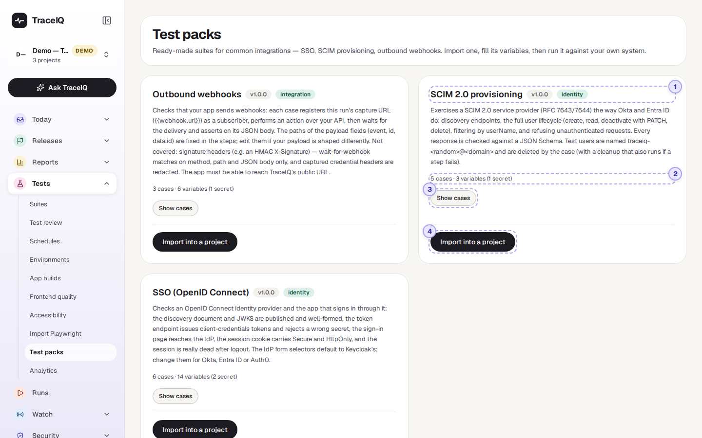
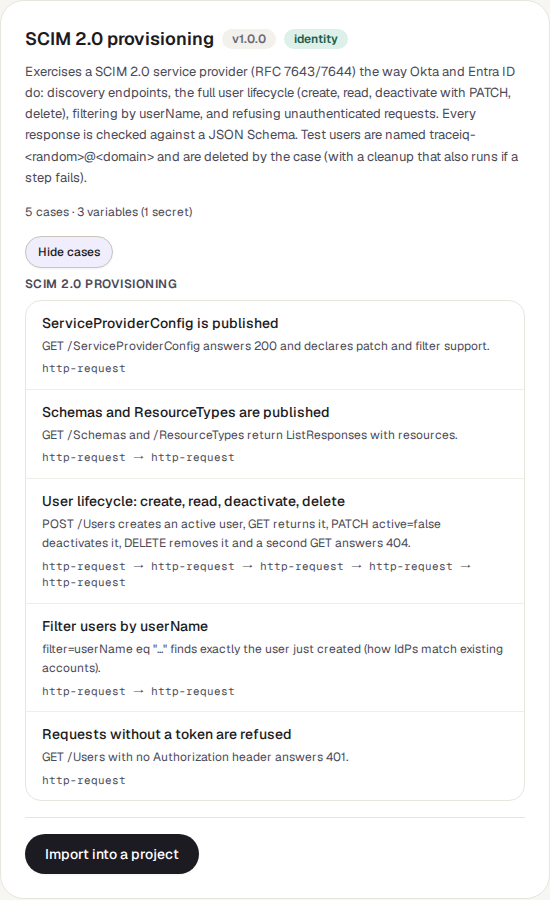

<!-- Generated from test-packs.html by e2e/docs-capture/export_md.py. Edit the HTML, not this file. -->

# Test packs

Tests · Everyone can see it · Editors can import into their projects

> **In short**
>
> Ready-made suites that come with TraceIQ, for things many systems have to get right: single sign-on, user provisioning and webhooks. Import one into a project, fill in a few values such as your server's address, and run it against your own system.

## What it is for

Some checks are the same for everyone: "does our sign-in through the company's identity provider really end the session at logout?", "do we send webhooks when we should?". Writing them from scratch takes days. A **test pack** answers **"Is there a good set of tests for this already?"**: a versioned suite whose tests use placeholders for everything specific to you.

> **Testers**
>
> Start from a complete, reviewed suite instead of an empty one.

> **Security and IT**
>
> Check an SSO or SCIM set-up the way identity providers such as Okta and Entra ID use it.

> **Developers**
>
> Prove that the app's webhooks fire and carry the right data.

**Where to find it:** in the sidebar, open **Tests → Test packs**.

## A tour of the screen

One card per pack. The numbers on the screenshot are on the *SCIM 2.0 provisioning* card; every card has the same parts.

*The Test packs page. Click the picture to see it larger.*

## 1. Title, version, category

The pack's name, its **version** (for example v1.0.0) and its category (identity or integration), then a description of what it checks and, often, what it doesn't. Read it before importing: it says what your system has to allow, for example that your app must be able to reach TraceIQ for the webhook pack.

| Pack | What it checks |
|---|---|
| **Outbound webhooks** | That your app sends a webhook (a message to another system) when something happens, and what the message contains. 3 tests. |
| **SCIM 2.0 provisioning** | That your system can have users created, found, switched off and deleted automatically by an identity provider, the way Okta and Entra ID do it. 5 tests. |
| **SSO (OpenID Connect)** | That your identity provider is set up correctly, and that your app's sign-in through it works and ends properly at logout. 6 tests. |

## 2. The counts line

For example *"5 cases · 3 variables (1 secret)"*: how many tests the pack holds, how many values you will be asked for when you import it, and how many of those are secrets (passwords or tokens).

## 3. Show cases

Lists the pack's tests, grouped by suite: each one's name, a sentence about what it does, and the kinds of steps it uses, in order (for example *http-request → http-request*). **Hide cases** folds the list again.

## 4. Import into a project

- **Project**: where the pack's suite is created. The project selected in the sidebar is chosen first.
- **Environment for the variables**: which environment of that project receives the values (see *Environments*). *Project default* uses the default one, and creates one called "default" if the project has none.
- **Variables**: one field per value the tests need, with a description. Required ones must be filled before the tests can work; Secret ones are typed hidden and stored as encrypted project secrets. Some show a default, used when you leave them empty.
- **Import pack** creates a suite named "*pack name* pack v*version*" with the pack's tests. A summary then says where the values went, and lists anything **still to fill before running**, with buttons to open the suite or the Environments page.

## Watch it in use

[▶ Watch the video](../media/tests/test-packs/walkthrough.mp4)

*About 45 seconds, with a spoken commentary. The captions at the bottom show the same words, so it also works with the sound off.*

## How to…

### …check your SCIM set-up

1. On the **SCIM 2.0 provisioning** card, press **Import into a project**.
2. Choose the project and the environment, and fill in `SCIM_BASE_URL` (your system's SCIM address) and `SCIM_TOKEN` (the token an identity provider would use).
3. Press **Import pack**, then **Open the suite**.
4. Press **Run suite**. The tests create a temporary user, work with it, and delete it again.

### …fill in a value you skipped

1. Open **Tests → Environments** and click the environment the pack's values went to.
2. Press **Edit** and add the variable with the name the summary listed. For a secret, use **Secrets** instead.

## Good to know

- **Who can do what.** Every signed-in user can browse the packs. Importing needs the *editor* role in the target project.
- **Importing runs nothing.** No test runs and your system isn't contacted until you run the suite yourself.
- **One copy per version.** Importing the same pack version into a project twice is refused, because the suite name already exists. Rename or delete the first copy to import again.
- **What gets overwritten.** A value you type replaces the same-named value in the chosen environment, and a secret you type replaces the same-named project secret. A *default* never replaces a value the environment already has.
- **The imported suite is yours.** Change its tests freely; a later version of the pack doesn't update it.
- **Every import is recorded** in the audit log, with the names of the values set (never the secret values).

## Related pages

> **Analytics**
>
> The next page in this guide: which tests fail most, which are slowest, which are flakiest.

> **Environments**
>
> Where a pack's values and secrets end up.

> **Suites**
>
> Where the imported suite appears and is run.

> **Import Playwright**
>
> Bring in tests your developers have already written as code.

## Video script

What the walkthrough says, in order. The video and every picture on this page are made by the Playwright script [`tests-test-packs.spec.ts`](../../../../e2e/docs-capture/pages/tests-test-packs.spec.ts).

1. Test packs are ready-made suites for common integrations, written by the TraceIQ team.
2. Each card is one pack: its name, its version, and what it checks.
3. Show cases lists the tests inside, and the kinds of steps each one uses.
4. Import into a project copies the pack into one of your projects as a new suite.
5. You choose the project, the environment, and fill in the pack’s values, such as your server’s address.
6. Values marked Secret are stored encrypted, and are never shown again.
7. Importing runs nothing. Cancel closes the dialog without importing.
