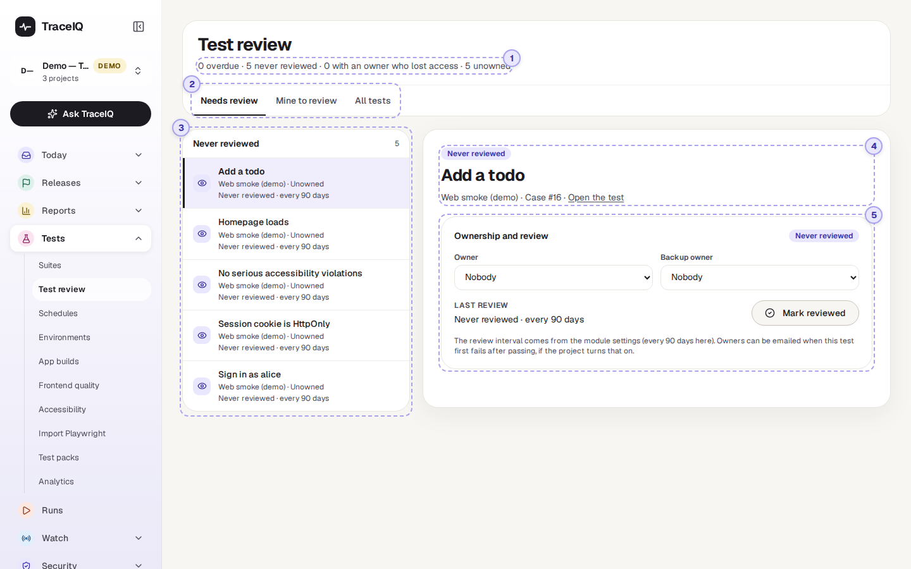
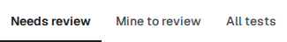
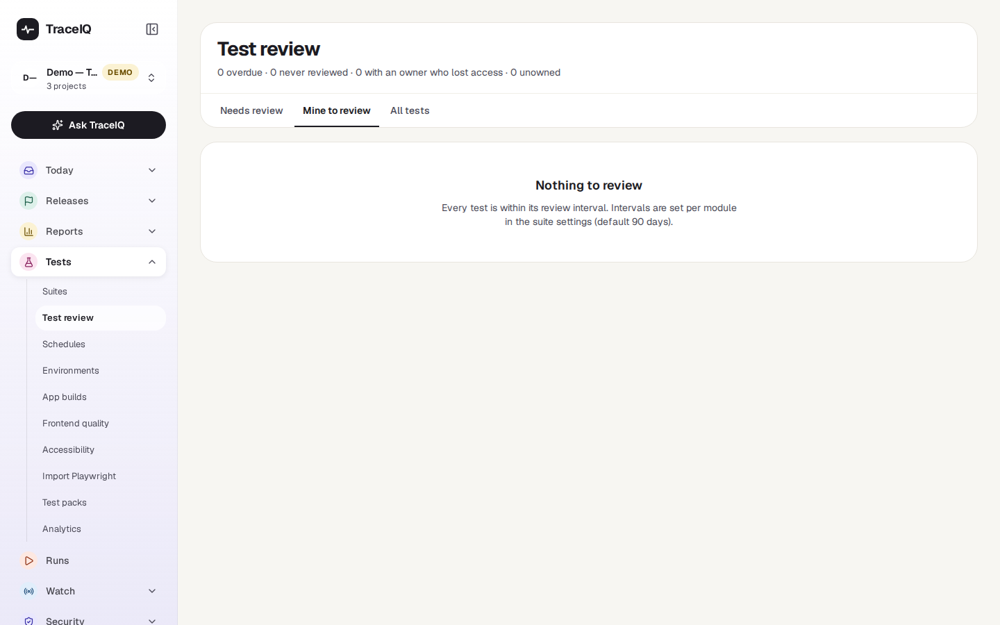
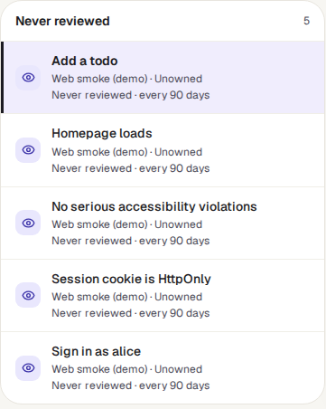
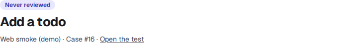
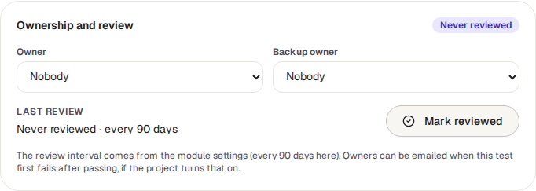

<!-- Generated from test-review.html by e2e/docs-capture/export_md.py. Edit the HTML, not this file. -->

# Test review

Tests · Everyone with access to the project can see it · Editors can change it

> **In short**
>
> Every test should have someone who looks after it, and every so often someone should check that it still tests something worth testing. This page lists the tests that are due for that check, or whose owner has moved on.

## What it is for

Tests pile up. Some stop making sense after the app changes, some keep passing while checking nothing useful, and some belong to a person who has left the team. Test review answers **"Which tests has nobody looked at for a while, and who should?"** Each test can have an **owner** and a **backup owner**, and a **review interval** (90 days unless a suite sets another one).

> **Testers**
>
> Work through the tests you own that are due, and mark each one reviewed.

> **Leads**
>
> Give every test an owner, and spot tests left behind by someone who no longer has access.

> **Auditors**
>
> See that tests are checked on a schedule, by a named person, with the date recorded.

**Where to find it:** in the sidebar, open **Tests → Test review**. It shows the project selected at the top of the sidebar.

## A tour of the screen

The list of tests is on the left; the one you pick is shown on the right. The numbers on the screenshot match the sections below.

*The Test review page for the demo's web project, where no test has been reviewed yet. Click the picture to see it larger.*

## 1. The counts line

Under the heading, for example *"0 overdue · 5 never reviewed · 0 with an owner who lost access · 5 unowned"*. It counts the tests of the whole project (on *Mine to review*: only your own), whichever tab you are on.

| Status | What it means |
|---|---|
| Never reviewed | Nobody has marked the test reviewed yet. |
| Review overdue | The last review is older than the interval, for example more than 90 days ago. |
| Reviewed | Reviewed within the interval. The row says when, and in how many days the next review is due. |
| No review needed | The suite's interval is set to 0, which switches periodic review off for it. |

## 2. The tabs

- **Needs review** (shown first): only tests that are *never reviewed* or *overdue*.
- **Mine to review**: the same, but only tests where *you* are the owner. Being the backup owner doesn't count here.
- **All tests**: every test in the project, whatever its status.

*Mine to review for someone who owns no tests that are due.*

## 3. The list

Tests are boxed in this order: **Owner no longer has access**, **Review overdue**, **Never reviewed** and, on *All tests*, **Up to date**. Inside a box, the test that has been overdue longest comes first. Each row shows the suite, the owner ("Unowned" if there is none), and the review status in words. **Click a row** to show it on the right.

## 4. The selected test

The status, the test's name, its suite and number, and **Open the test**, which opens it in the step editor so you can read what it does before deciding.

## 5. Ownership and review

- **Owner** and **Backup owner**: pick a person from the list. The list holds the workspace members who can edit this project. **The choice is saved as soon as you pick it**; there is no Save button. The two must be different people.
- **Last review**: when the test was last marked reviewed, and by whom.
- **Mark reviewed**: press it once you have checked that the test still makes sense. It records today's date and your name, and the next review falls due after the interval.

The same box appears at the top of the step editor when you edit a test (see *Suites*).

## Watch it in use

[▶ Watch the video](../media/tests/test-review/walkthrough.mp4)

*About a minute, with a spoken commentary. The captions at the bottom show the same words, so it also works with the sound off.*

## How to…

### …review a test

1. On **Needs review** (or **Mine to review**), click the test at the top of the list.
2. Press **Open the test** and read its steps. Ask: does it still check something users rely on? Would it fail if that broke?
3. If it needs changing, change it in the editor. If it is no longer useful, delete it from its suite.
4. Back on this page, press **Mark reviewed**. The test leaves the Needs review list.

### …give a test an owner

1. Click the test in the list.
2. Choose a person under **Owner**, and someone else under **Backup owner**. Each choice is saved straight away.

### …change how often tests are reviewed

1. Open the suite (**Tests → Suites**) and go to its **Settings** tab. Changing suite settings needs *project admin*.
2. Under **Test review**, enter a number of days (up to 3650), or 0 for no periodic review. Leave it empty to use the suite above it, or 90 days.
3. The new interval applies to every test in the suite and in its sub-modules that don't set their own.

## Good to know

- **Who can do what.** Anyone with access to the project can look. Choosing owners and marking tests reviewed needs the *editor* role.
- **Only a person can mark a test reviewed.** AI agents and scripts using an API key are refused, because a review is meant to be a human check.
- **Owners are never removed by themselves.** If an owner loses access to the project or their account is switched off, the test keeps them, labelled "(no longer has access)", so someone notices and picks a new owner.
- **Owners can be told when their test breaks.** If the project has switched it on (*Project settings → Notifications → Tell a test's owner when it starts failing*), the owner gets one email the first time the test fails after passing; the backup owner gets it if the owner can't be reached. Failures caused by the test machines, time-outs and cancelled runs don't count.
- **Every change is recorded.** Owner changes and reviews are written to the audit log.
- **Ownership isn't part of the test.** Changing an owner or marking a test reviewed doesn't create a new version of the test in its *History*.
- **Very large projects**: the list shows the first 1,000 tests and says so.

## Related pages

> **Schedules**
>
> The next page in this guide: run suites and tests automatically, on a timer.

> **Suites**
>
> Where tests live; a suite's Settings tab sets its review interval.

> **Flaky tests**
>
> Tests that pass and fail at random, which also have owners.

> **Project settings**
>
> Switch on the email to a test's owner when it starts failing.

## Video script

What the walkthrough says, in order. The video and every picture on this page are made by the Playwright script [`tests-test-review.spec.ts`](../../../../e2e/docs-capture/pages/tests-test-review.spec.ts).

1. Test review lists the tests that a person should look at again.
2. The line at the top counts tests that are overdue, never reviewed, or without an owner.
3. Needs review shows only the tests that are due. All tests shows every test.
4. Each row shows the suite, the owner, and when the test was last reviewed.
5. On the right: who owns the test, and a backup in case they are away.
6. Picking a person saves straight away. Editors can change it.
7. After checking that the test is still worth having, press Mark reviewed.
8. The review then comes round again after the suite’s interval: ninety days, unless it is changed.
9. Mine to review shows only the tests you own.
