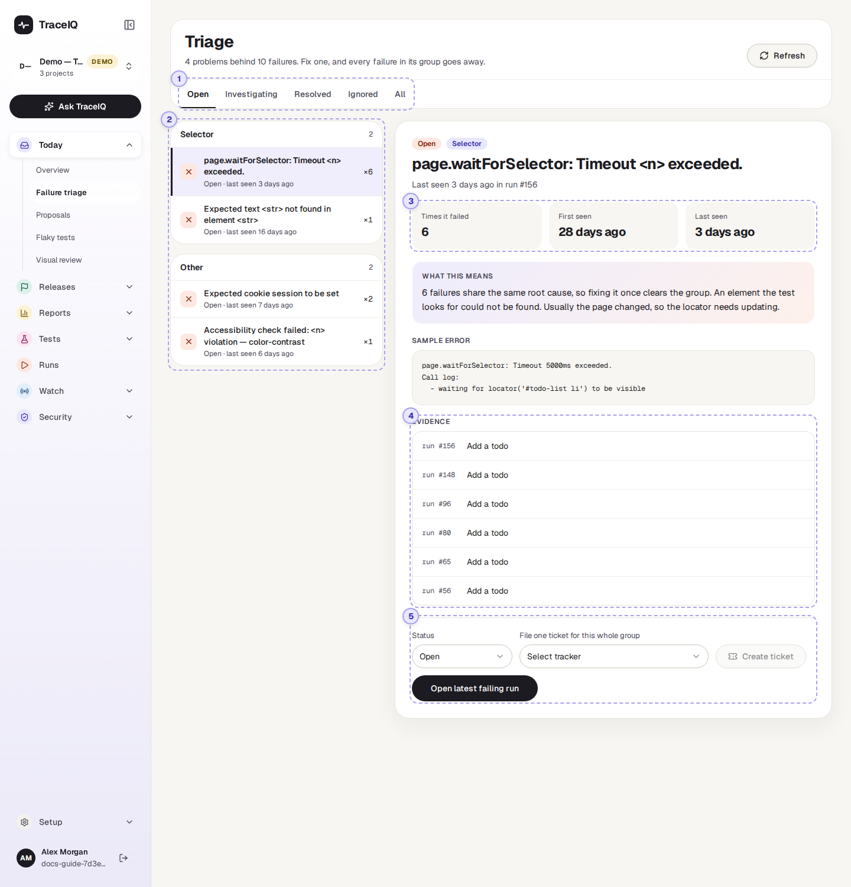
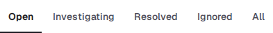
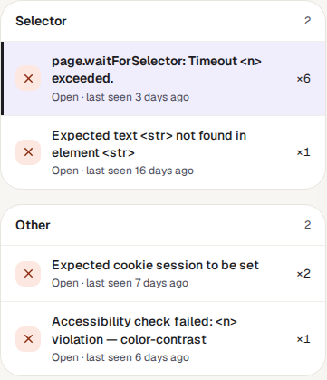
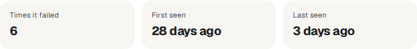
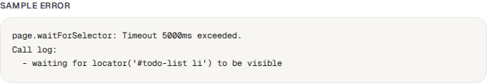
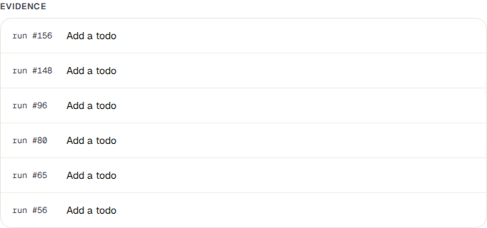
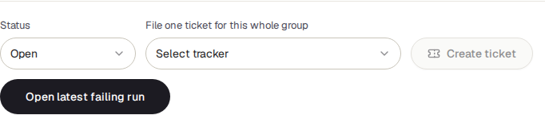

<!-- Generated from failure-triage.html by e2e/docs-capture/export_md.py. Edit the HTML, not this file. -->

# Failure triage

Today · Everyone with access to the project can see it · Editors can change it

> **In short**
>
> When tests fail, TraceIQ puts failures with the same cause into one group. Instead of reading twenty failed runs, you look at the three or four problems behind them, fix each one once, and mark it as dealt with.

## What it is for

Failure triage answers **"What is actually broken, and what should I look at first?"** One broken button can fail the same test every night for a week, or fail ten different tests in one run. On the run pages that looks like many failures. On this page it is **one problem**, with a count of how many times it happened.

> **Testers**
>
> Start the day with the biggest problem, not the most recent failure. Decide whether it's the app or the test that needs fixing.

> **Developers**
>
> See the exact error message and every test it broke, then open a run to look at the screenshots and logs.

> **Leads**
>
> Know how many separate problems there are and who is working on them, and file one ticket per problem instead of one per failure.

**Where to find it:** in the sidebar, open **Today → Failure triage**. The page's own heading says **Triage**.

## A tour of the screen

The page shows the project selected at the top of the sidebar. The list of problems is on the left; the one you pick is shown in detail on the right. The numbers on the screenshot match the sections below.

*The Failure triage page for the demo's web project. Click the picture to see it larger.*

The line under the heading sums it up, for example *"4 problems behind 10 failures"*: four separate causes, which between them made tests fail ten times. It counts only the problems on the tab you are looking at.

## 1. The status tabs

Every problem has a status, and the tabs show one status at a time. **Open** is selected when the page opens, because those are the problems nobody has dealt with yet.

| Status | What it means |
|---|---|
| Open | New, and nobody has looked at it yet. Every new problem starts here. |
| Investigating | Someone is working out the cause or fixing it. |
| Resolved | Fixed. TraceIQ notes the time, which the reports use to show how quickly problems get fixed. If it fails again later, TraceIQ moves it back to *Open* by itself. |
| Ignored | Known and accepted, for now. It no longer shows under Open, and stays Ignored even when it fails again (its count keeps going up). |
| **All** | Every problem, whatever its status. |

## 2. The list of problems

Problems are boxed by **kind** (see the table below). The box with the most failures comes first, and inside a box the most frequent problem comes first. The small number next to a box's name is how many problems it holds.

- **The name** of a problem is its error message (the first line).
- **Underneath:** its status, and how long ago it last happened.
- **×6** on the right means it has made a test fail six times so far.
- **The icon** on the left is a cross for Open and Investigating, a tick for Resolved, and a dash for Ignored.
- **Click a problem** to show it on the right. Until you do, the most frequent one is shown.

> **What &lt;n&gt; and &lt;str&gt; mean**
>
> Two failures belong together when their error messages say the same thing. Details that change from one failure to the next, such as a number of seconds or an ID, would keep them apart, so TraceIQ swaps those details for a placeholder before comparing:
>
> - `<n>` = a number, e.g. "5000ms" or "502"
> - `<str>` = text in quotes, e.g. a button's label or a page element
> - `<url>` = a web address, `<path>` = a file path, `<uuid>` and `<hex>` = IDs
>
> So "Expected status 200 but got 502" and "Expected status 200 but got 503" are one problem: *Expected status &lt;n&gt; but got &lt;n&gt;*. The full message, with the real values, is under [Sample error](#facts).

| Kind | What it usually means |
|---|---|
| Selector | Something the test looks for on the page could not be found, or did not appear in time. Usually the page changed, so the test needs updating. |
| Assertion | The page loaded but showed something different from what the test expected. The kind most likely to be a real bug. |
| Timeout | Something took longer than the test was willing to wait. Check for a slow server or a problem with the test environment before blaming the test. |
| Network | A request failed, got an error status (such as 502), or got no answer. Often the environment, not the code. |
| Navigation | The browser could not open or finish loading a page. |
| Other | Failures with the same message that don't fit any of the kinds above. |

> **The kind is a best guess**
>
> TraceIQ picks the kind from words in the error message, checking for Selector first, then Assertion, Timeout, Network and Navigation. A test that timed out while waiting for a button is therefore a *Selector* problem, not a Timeout. And "Expected text … not found in element …" is a Selector problem too, even when the element was there with the wrong text. Read the error before deciding who should fix it.

## 3. The selected problem

At the top: the problem's status and kind, its name, and the last run it happened in. Then three facts:

| Fact | What it tells you |
|---|---|
| **Times it failed** | How many test results this problem has caused, since it first appeared. Ten tests failing in one run count as ten. |
| **First seen** | When it happened for the first time. A problem first seen today is probably caused by something that changed today. |
| **Last seen** | When it happened most recently. If that was weeks ago, it may already be fixed. |

**What this means** repeats, in plain words, what this kind of problem usually comes down to (the same explanations as the table above).

**Sample error** is the complete message from the *first* failure in the group, with the real numbers and text in place of the placeholders. It is often more than one line: Playwright adds a "Call log" saying exactly what it was waiting for.

## 4. Evidence

One row per failure in the group, newest first: the run it happened in, and the name of the test that failed. **Click a row** to open that run, with its screenshots, step-by-step results and logs. The list shows up to the **50 newest** failures; *Times it failed* counts all of them.

If every row names the same test, one test keeps failing in the same way. If the rows name many different tests, one cause (often a shared page or a server problem) is breaking all of them.

## 5. Status and ticket

- **Status** moves the problem to Open, Investigating, Resolved or Ignored. The change is saved straight away, and the problem leaves the tab you are on and appears under its new status.
- **File one ticket for this whole group**: choose an issue tracker (Jira, GitHub or iTop), then press **Create ticket**. TraceIQ files one ticket for the whole problem, titled "[TraceIQ] *kind*: *problem name*", with the number of failures, the sample error, and the screenshots, video and trace of the latest failing run (whatever that run recorded). The ticket is created in the background; you'll see "Ticket queued for this cluster".
- **Open latest failing run** takes you to the newest run where the problem happened.

> **No trackers in the list?**
>
> The list shows the issue trackers set up in **Setup → Issue trackers** for the workspace this project belongs to, and switched on. Linear connections are missing on purpose: TraceIQ only imports from Linear and can't create tickets there.

## Watch it in use

[▶ Watch the video](../media/today/failure-triage/walkthrough.mp4)

*About a minute and a quarter, with a spoken commentary. The captions at the bottom show the same words, so it also works with the sound off.*

## How to…

### …work through today's failures

1. Make sure the right project is selected at the top of the sidebar.
2. Stay on the **Open** tab. The problem at the top of the first box is the one that has failed most often.
3. Read its **Sample error**, then click a row under **Evidence** to see the screenshots of that run.
4. Set the status to **Investigating**, so colleagues can see someone is on it.
5. Once it is fixed, set it to **Resolved**. Then move on to the next problem.

### …hand a problem to the development team

1. Click the problem in the list.
2. Under **File one ticket for this whole group**, choose your tracker.
3. Press **Create ticket**. One ticket covers every failure in the group, so the team isn't sent the same bug many times.
4. Set the status to **Investigating**.

### …check whether a fixed problem has come back

1. You don't need to look: when a **Resolved** problem fails again, TraceIQ moves it back to the **Open** tab.
2. On the Open tab, a problem whose *First seen* is long ago but *Last seen* is recent has usually come back after a fix. Its count includes the failures from before the fix too.
3. Set it to **Investigating** and look at what changed since it was fixed.

## Good to know

- **A resolved problem reopens by itself.** If the same failure happens again, it is added to the existing problem and moved back to *Open*. Ignored and Investigating problems keep their status; only their count and *last seen* change.
- **Grouping happens when a run finishes.** Every test that ended *Failed* or *Error* is added to a group. Tests that were *Cancelled* or *Timed out* are not; nor are the check runs TraceIQ makes for a suggested fix (see *Proposals*).
- **The test's name doesn't matter, only the message.** Different tests that fail with the same message share one problem. The same test failing with two different messages makes two problems.
- **One project at a time.** Problems belong to a project. Switch project at the top of the sidebar to see another one's.
- **It doesn't update by itself.** Press **Refresh** (top right) to fetch new failures. The page also refreshes when you come back to its browser tab.
- **Who can do what.** Anyone with access to the project can look. Changing a status or filing a ticket needs the *editor* role; others see "Editor role required".
- **Your clicks feed the reports.** The first time a problem is set to Investigating or Resolved counts as "diagnosed" in the *Value report*, and the time it is resolved is used to measure how quickly problems get fixed.

## Related pages

> **Runs**
>
> Each run's full result: every step, screenshot, video and log, plus AI analysis of what went wrong.

> **Proposals**
>
> The next page in this guide: fixes TraceIQ suggests for broken tests, such as a new way to find a button that moved.

> **Flaky tests**
>
> Tests that pass and fail without anything changing. They also show up here when they fail, so check there first.

> **Issue trackers**
>
> Connect Jira, GitHub or iTop so you can file tickets from this page.

## Video script

What the walkthrough says, in order. The video and every picture on this page are made by the Playwright script [`today-failure-triage.spec.ts`](../../../../e2e/docs-capture/pages/today-failure-triage.spec.ts).

1. Failure triage groups failed tests by their cause, so one problem is one item.
2. The line at the top says how many problems there are, and how many failures they caused.
3. The tabs choose which problems to show. Open is chosen first.
4. Problems are grouped by kind. The number on the right is how many times it failed.
5. Click a problem to see its details on the right.
6. How often it failed, when it was first seen, and when it was last seen.
7. The sample error is the message from one of these failures.
8. Evidence lists each failing test and the run it came from. Click one to open that run.
9. When you start on a problem, set it to Investigating. Set it to Resolved once it is fixed.
10. Open latest failing run takes you to the newest run where it happened.
