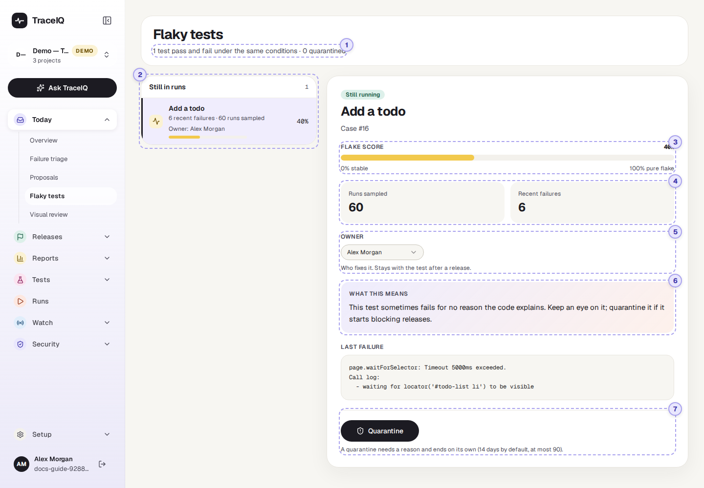
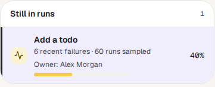
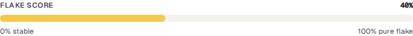
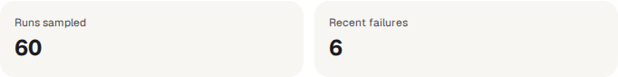
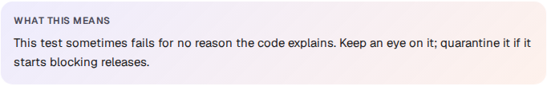
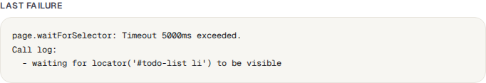
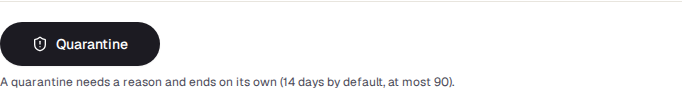
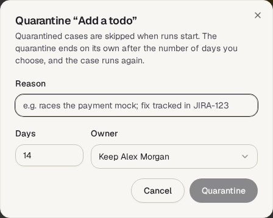

<!-- Generated from flaky-tests.html by e2e/docs-capture/export_md.py. Edit the HTML, not this file. -->

# Flaky tests

Today · Everyone with access to the project can see it · Editors can change it

> **In short**
>
> A flaky test passes one time and fails the next, without anything having changed. This page scores every test on how often that happens, names who should fix it, and lets you **quarantine** one: take it out of runs for a set number of days so it stops turning your results red.

## What it is for

Flaky tests answers **"Which tests can't I trust, and what are we doing about them?"** A flaky test is worse than useless: when it fails, people learn to shrug, and then they shrug at a real failure too. Here you see which tests flip between pass and fail, decide whether to keep them in runs, and give each one an owner.

> **Testers**
>
> Find the tests that fail for no reason, and quarantine the worst while they are being fixed.

> **Developers**
>
> See the flaky tests they own and the last error, which usually points at a timing or test-data problem.

> **Leads**
>
> Check that every quarantined test has an owner, a reason and an end date, so nothing stays hidden for ever.

**Where to find it:** in the sidebar, open **Today → Flaky tests**.

## A tour of the screen

The page shows the project selected at the top of the sidebar. The tests are listed on the left; the one you pick is shown in detail on the right. The numbers on the screenshot match the sections below.

*The Flaky tests page for the demo's web project, which has one flaky test. Click the picture to see it larger.*

## 1. The summary line

Under the heading, for example *"1 test pass and fail under the same conditions · 0 quarantined"*: how many tests are in the list, and how many of them are quarantined right now.

## 2. The list of tests

Tests are boxed by what is happening to them, highest score first in each box:

| Box | What it holds |
|---|---|
| **Needs a decision** | Tests whose quarantine has ended. They *run again*, but someone should either release them for good or quarantine them again. Shown first for that reason. |
| **Still in runs** | Tests that are not quarantined and run normally. |
| **Quarantined** | Tests that are being skipped right now. |

Each row shows the test's name, its failures in the last 30 days, how many results its score is based on, its owner (or "Unowned"), a small score bar, and the score itself on the right. **Click a row** to show it on the right; until you do, the first one is shown.

## 3. The flake score

How often the test's result **flipped** between pass and fail over its most recent results. TraceIQ looks at the last 20 results of the test (in this project), counts how many times the result changed from one to the next, and divides by the number of chances it had to change.

- Passed every time: **0%**. Failed every time: also **0%**. A test that is always red is broken, not flaky.
- Pass, fail, pass, fail…: **100%**.
- Cancelled and timed-out runs, failures caused by the test machine itself (for example a browser crash), and TraceIQ's own check runs for a *Proposals* fix don't count either way.

| Bar colour | Score | What it says |
|---|---|---|
| Green | below 33% | Mostly stable. |
| Yellow | 33% to 65% | Sometimes fails for no reason. Keep an eye on it. |
| Orange | 66% and above | Its result tells you little. Quarantine it and fix it. |

The score is recalculated each time a run that includes the test finishes.

## 4. Runs sampled and recent failures

| Fact | What it tells you |
|---|---|
| **Runs sampled** | How many results the score is based on (at most the last 20 in a real project; the demo's made-up history says 60). With only a handful, the score is a rough guess. |
| **Recent failures** | How many times a test with this name ended *Failed* or *Error* in this project in the last 30 days. |

## 5. The owner

The person who will fix the test. Pick someone from the menu (or *Unowned*); the change is saved straight away and written to the audit log. The menu lists the workspace's members who can edit this project, because only they could fix it. The owner stays with the test after its quarantine ends.

## 6. What this means, and the last failure

**What this means** puts the score, or the quarantine, into plain words and suggests what to do. Below it, **Last failure** is the error message from the most recent failure among the results the score was based on.

In the demo the test waited 5 seconds for the new item to appear in the list. A wait that is sometimes too short is the most common cause of a flaky test.

## 7. Quarantine and release

A **quarantined** test is left out of every run while the quarantine lasts, so its random failures stop blocking your results. It is not deleted, and its steps don't change.

- **Quarantine** opens a short form: a **reason** (required), the number of **days** (1 to 90, 14 suggested) and the **owner**. With no owner chosen, the current owner is kept; if there is none, you become the owner.
- **Release back into runs** ends a quarantine early, once the cause is fixed.
- **Quarantine again** appears when a quarantine has ended, for when the test still needs time.

*The quarantine form. The Quarantine button stays grey until you type a reason.*

Once quarantined, the detail shows Quarantined and a line such as *"Until 4 Nov 2026 · races the payment mock"*. A quarantine that has ended shows Quarantine expired; a test that is not quarantined shows Still running.

## Watch it in use

[▶ Watch the video](../media/today/flaky-tests/walkthrough.mp4)

*Just under a minute, with a spoken commentary. The captions at the bottom show the same words, so it also works with the sound off.*

## How to…

### …stop a flaky test from blocking runs while it is fixed

1. Click the test in the list and read its **Last failure**.
2. Press **Quarantine**.
3. Write why, for example *"waits too short for the list; fix in JIRA-123"*, choose how many days, and pick the owner.
4. Press **Quarantine**. The test moves to the Quarantined box and is skipped from the next run on.

### …bring a fixed test back

1. Click the test in the **Quarantined** box.
2. Press **Release back into runs**. It runs again from the next run.

### …deal with a quarantine that has ended

1. Look at the **Needs a decision** box at the top of the list. These tests are already running again.
2. If the cause is fixed, press **Release back into runs** to clear the flag.
3. If not, press **Quarantine again** with a new reason and length.

## Good to know

- **TraceIQ quarantines on its own, too.** When a test reaches a score of 40% or more over at least 6 results and isn't quarantined, it is quarantined automatically for 14 days. Its reason then starts with "auto:", for example "auto: flake score 0.45 over 12 runs". An automatic quarantine is lifted by itself if the score drops below 15%; one that a person set never is.
- **An ended quarantine is never renewed by itself.** The test runs again, and only a person can quarantine it again.
- **The list isn't only flaky tests.** Every test that has run gets a score, so in a project with history the list also holds stable tests at 0%, and the summary line counts them too. Look at the score and colour, not just at whether a test is listed.
- **Tests are matched by name.** The score and the failure count follow the test's name within the project; two tests with the same name are counted together.
- **A quarantine shows up elsewhere.** *Release readiness* lists the active quarantines, with owner and end date, and can be set to refuse a release when too many tests are quarantined or score 40% or more.
- **Who can do what.** Anyone with access to the project can look. Quarantining, releasing and changing the owner need the *editor* role, and every one of them is written to the audit log.
- **It doesn't update by itself.** It fetches new scores when you come back to its browser tab, or when you reload it.

## Related pages

> **Visual review**
>
> The next page in this guide: screenshots that changed since they were last approved.

> **Flake trends**
>
> Whether the project is getting more or less flaky over time, and when flaky failures tend to happen.

> **Failure triage**
>
> Failures grouped by cause. A flaky test's failures show up there too, so check here first.

> **Release readiness**
>
> A ready / not-ready verdict that can take quarantined tests into account.

## Video script

What the walkthrough says, in order. The video and every picture on this page are made by the Playwright script [`today-flaky-tests.spec.ts`](../../../../e2e/docs-capture/pages/today-flaky-tests.spec.ts).

1. A flaky test passes and fails without anything changing. This page lists them.
2. Each row shows a test, its recent failures, its owner, and its flake score.
3. The flake score: how often the result flipped between pass and fail, recently.
4. How many results the score is based on, and how many failed in the last thirty days.
5. The owner is the person who will fix it.
6. What this means explains the score in plain words. Below it is the last error.
7. Quarantine takes it out of runs for a while, so it stops blocking your results.
8. You give a reason and a number of days. It comes back on its own when they are up.
9. We cancel here, so nothing changes.
