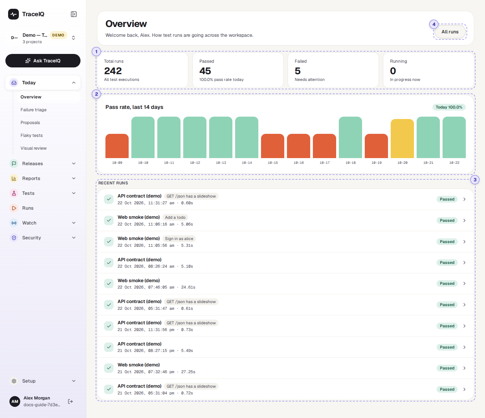
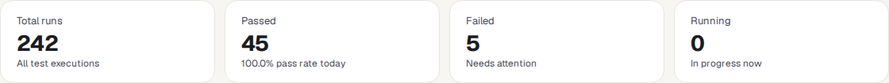
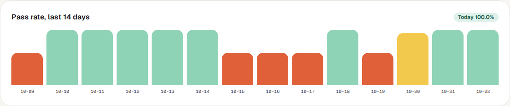
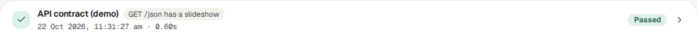

<!-- Generated from overview.html by e2e/docs-capture/export_md.py. Edit the HTML, not this file. -->

# Overview

Today · Everyone can see it · Read-only page

> **In short**
>
> Your home page. In a few seconds it tells you how testing is going: how many runs there have been, how many passed or failed, how the pass rate has moved over the last two weeks, and what ran most recently.

## What it is for

Overview answers one question: **"Is everything all right, or does something need my attention?"** It is the first page you see after signing in, and the page to come back to when you want a quick check before a meeting, a release or the end of the day.

> **Testers**
>
> See at a glance whether last night's runs passed, and jump straight to the ones that didn't.

> **Developers**
>
> Check that the run for their change finished, and how it went.

> **Leads and managers**
>
> Watch the trend: is quality steady, getting better or getting worse?

**Where to find it:** in the sidebar, open **Today → Overview**. TraceIQ also opens it automatically after you sign in.

## A tour of the screen

The page has four parts. The numbers on the screenshot match the sections below.

*The Overview page. Click the picture to see it larger.*

## 1. The four tiles

| Tile | What the number means |
|---|---|
| **Total runs** | Every run you are allowed to see, in *all* your projects, since the beginning. |
| **Passed** | How many of the **50 most recent runs** passed. The small line underneath shows the pass rate for *today* in the project selected in the sidebar. |
| **Failed** | How many of the **50 most recent runs** failed. If it is above zero, it says "Needs attention". |
| **Running** | How many of the **50 most recent runs** are running right now. |

> **Why Passed + Failed doesn't add up to Total**
>
> *Total runs* counts all of history, but *Passed*, *Failed* and *Running* only look at the newest 50 runs. In the screenshot, 242 runs exist in total; of the newest 50, 45 passed and 5 failed. Read the three smaller tiles as "lately", not "ever".
>
> Also, *Failed* counts only runs marked Failed. Runs that ended in Error or Timed out are not in that number, so check the list of recent runs too.

## 2. Pass rate, last 14 days

One bar for each of the last 14 days, oldest on the left and today on the right. The taller the bar, the higher that day's pass rate. The label in the top-right corner repeats today's pass rate.

| Bar colour | Meaning |
|---|---|
| Green | 90% or more of that day's runs passed. A healthy day. |
| Yellow | Between 60% and 89% passed. Worth a look. |
| Orange | Less than 60% passed. Something was wrong that day. |
| Grey stub | No runs finished that day, so there is nothing to measure. |

**Point at a bar** to see that day's exact numbers, for example *"2026-10-14: 50.0% pass rate (1 passed / 1 failed of 2 runs)"*.

> **Which runs the chart counts**
>
> - **Only the project selected in the sidebar.** The tiles and the run list cover all your projects; the chart covers one. Switch project with the project picker at the top of the sidebar.
> - **Pass rate = passed ÷ (passed + failed + error).** Runs that were cancelled, timed out, or are still queued or running are left out, because they have no pass/fail answer.
> - Re-runs that TraceIQ makes only to *check a suggested fix* (see *Proposals*) are left out too, so they can't make a day look better or worse.
> - Days are calendar days in **UTC**. In India (UTC+5:30), a run at 2 a.m. counts towards the previous day.
>
> If no project is selected, or the project has no runs yet, the chart is not shown.

## 3. Recent runs

The 10 newest runs across all your projects, newest first. Each row is one run:

- **The icon on the left** repeats the result at a glance: a tick for passed, a cross for failed or error, a spinner while running, and a dash for anything else (queued, cancelled, timed out).
- **The name** is the suite that ran. If only one test was run instead of a whole suite, its name appears next to it in a grey label.
- **Underneath**: when the run started, and how long it took.
- **The coloured label on the right** is the result (see the table below).
- **Click anywhere on the row** to open the run's own page, with every test, step, screenshot and log.

| Label | What it means |
|---|---|
| Passed | Every test in the run did what it should. |
| Failed | At least one test found a problem: something on the page or in the response was not as expected. |
| Error | Something went wrong *around* the test rather than in it, for example a preparation step failed. Treat it like a failure: it needs a look. |
| Running | The run is happening right now. |
| Queued | The run is waiting for a free test machine and will start shortly. |
| Cancelled | Someone stopped the run before it finished. There is no verdict. |
| Timed out | The run went past TraceIQ's time limit and was stopped. There is no verdict. (A single step waiting too long on a page is a *Failed*, not a time-out.) |

## 4. All runs

The **All runs** button in the top-right corner opens the full list of runs, with search and filters by status, browser and device. It is the same page as **Runs** in the sidebar.

## Watch it in use

[▶ Watch the video](../media/today/overview/walkthrough.mp4)

*About one minute, with a spoken commentary. The captions at the bottom show the same words, so it also works with the sound off.*

## How to…

### …check whether anything needs attention

1. Look at the **Failed** tile. Zero means none of the latest runs failed.
2. Scan the coloured labels in **Recent runs** for *Failed*, *Error* or *Timed out*.
3. Click a run that isn't green to see what went wrong.

### …see whether quality is getting better or worse

1. Make sure the right project is selected at the top of the sidebar.
2. Read the chart from left to right. Several orange or yellow bars in a row means a lasting problem, not a one-off.
3. Point at a bar to see how many runs that day's percentage is based on. A day with 1 failed run out of 2 shows 50%, which looks worse than it is.

### …look at a different project

1. Click the project name at the top of the sidebar.
2. Choose the project. The chart and today's pass rate update straight away.

## Good to know

- **It updates by itself.** The tiles and the run list refresh every 15 seconds and the chart every minute, so you can leave the page open.
- **You only see your own projects.** Every number counts only the projects you have access to. Two people can see different numbers on the same page.
- **Nothing here can be changed.** Overview is read-only. To run tests, go to *Tests → Suites*.
- **A brand-new account** shows zeros and "No runs yet" until the first test runs.

## Related pages

> **Runs**
>
> The complete list of runs, with search and filters, and each run's full result.

> **Failure triage**
>
> The next page in this guide: failures grouped by cause, so you fix one problem instead of reading twenty runs.

> **Analytics**
>
> One project over 7, 30 or 90 days: which tests fail most, which are slowest, which are flakiest.

> **Release readiness**
>
> A clear "ready / not ready" answer for a specific version of your app.

## Video script

What the walkthrough says, in order. The video and every picture on this page are made by the Playwright script [`today-overview.spec.ts`](../../../../e2e/docs-capture/pages/today-overview.spec.ts).

1. Overview is the first page you see after signing in.
2. Total runs: every test run you can see, in all your projects.
3. Passed, Failed and Running count only the fifty most recent runs.
4. One bar per day: the share of runs that passed in the selected project.
5. Green means ninety percent or more passed. Yellow, sixty to eighty-nine percent. Orange, under sixty percent.
6. Recent runs shows the ten newest. Click one to open its full result.
7. This is the run page: every test, step, screenshot and log of that run.
8. All runs opens the complete list, with search and filters.
