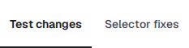
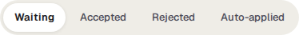
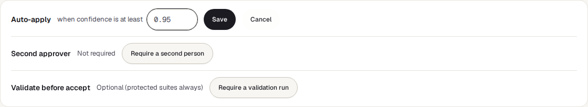

<!-- Generated from proposals.html by e2e/docs-capture/export_md.py. Edit the HTML, not this file. -->

# Proposals

Today · Everyone with access to the project can see it · Editors accept or reject · Workspace admins set the rules

> **In short**
>
> A review queue. When an AI agent wants to add, change, move or delete one of your tests, or TraceIQ finds a better way for a test to find a button that moved, the suggestion waits here. Nothing changes in your tests until a person accepts it.

## What it is for

Proposals answers **"What do agents and TraceIQ want to change in my tests, and is it safe?"** Agents that write code (for example a coding assistant connected through TraceIQ's API) can suggest new tests or edits, but they can't change a test directly. You see each suggestion next to the test as it is now, decide, and the change is applied only when you accept it.

> **Testers**
>
> Check that an agent's new or edited test really tests what it should, before it joins the suite.

> **Developers**
>
> Accept the test an agent wrote for their change, or fix a test whose button moved, in a couple of clicks.

> **Leads and admins**
>
> Decide how strict the review is: whether confident changes may go in by themselves, and whether a second person must approve.

**Where to find it:** in the sidebar, open **Today → Proposals**.

> **Two words used on this page**
>
> - A **test** (TraceIQ also says *test case*) is a list of **steps**: open this page, click that button, check this text.
> - A **selector** is how a step finds something on the page, for example `#login-submit` ("the element whose id is login-submit"). When a page is redesigned, a selector can stop matching and the step fails, even though the app works.

## A tour of the screen

The page has four parts. The numbers on the screenshot match the sections below. In the demo's web project three test changes are waiting: an edit to a test and two new tests.

*The Proposals page in the demo workspace, with three test changes waiting. Click the picture to see it larger.*

## 1. Two kinds of proposal

| Tab | What it holds |
|---|---|
| **Test changes** | Suggestions to **create** a new test, **update** one (its name, steps, tags or priority), **move** one to another suite, or **delete** one. They come from AI agents using TraceIQ's API, from the command-line tool's *push* (tests kept in a code repository), and from tests generated from *Requirements* or *Incidents*. Only the project selected at the top of the sidebar is shown. |
| **Selector fixes** | A new selector for one step of a test, suggested by TraceIQ when a step could not find its element during a run. This tab shows **every project you can see**, not only the one selected in the sidebar. |

## 2. The status filter

Shows one status at a time. **Waiting** is chosen when the page opens and every time you switch tab.

| Status | What it means |
|---|---|
| Waiting for review | Nobody has decided yet. Nothing in your tests has changed. |
| Accepted | Someone accepted it and the change was applied. On the Test changes tab this also includes changes that went in by themselves through [auto-apply](#policy). |
| Rejected | Someone turned it down. The test was not changed. |
| Auto-applied | Selector fixes tab only. TraceIQ does not currently apply selector fixes without a person, so this list stays empty. |

## 3. The review policy

Three rules for the whole **workspace** the selected project belongs to. Everyone can read them; only a **workspace admin** can change them, and only admins see the buttons. They sit one under the other, side by side only on very wide screens. The second and third buttons save as soon as you press them.

| Rule | What it does |
|---|---|
| **Auto-apply** | Off by default. With a threshold set (for example *confidence ≥ 0.95*), a *new* test or an *edit* whose confidence is at least that high is applied the moment it arrives, without waiting here. Moves, deletions and selector fixes always wait for a person. Press **Edit**, type a number between 0 and 1, and press Save; leave it empty (or 0) to switch it off. A server administrator can switch auto-apply off for everyone; the card then says so. |
| **Second approver** | When required, the person behind a proposal can't accept it themselves; someone else must. That includes proposals an agent sent with your API key. Rejecting your own proposal is always allowed. |
| **Validate before accept** | When required, an edit to a test's steps, or a selector fix, must first pass a [validation run](#validate). Tests in a suite marked *protected* always need one, whatever this says. |

*Auto-apply after pressing Edit. Cancel leaves it as it was.*

> **"Enforced for the whole instance"**
>
> A server administrator can require a second approver or a validation run for every workspace. The rule then shows Required with this note, and the workspace can't switch it off.

## 4. The queue

The list is on the left and the proposal you pick is shown in detail on the right (the first one is shown until you pick another). When there is nothing to show you see a message such as *"No test proposals waiting for review"*.

### A test change

The list is boxed by what the change would do, the riskiest first: **Delete**, **Update**, **Create**, **Move**, then **Other** (changes to a suite's shared settings). Each row shows the test's name, the agent that sent it and how long ago, and the agent's confidence on the right, from 0% to 100%. An edit that doesn't rename the test is listed by the test's current name (or by its number, such as *Case #42*, if the test has since been deleted).

*An edit proposed by an agent: the last step's selector changes, the rest stays.*

The detail shows, from top to bottom:

- **Labels**: what it would do, its status, and the confidence (green from 80%, yellow from 50%, grey below).
- **Who wants it**: "*agent* wants to add a new test", with the date.
- **Why the agent proposes this**: the agent's own explanation.
- **The change itself.** A new test lists its proposed steps. An edit shows the current steps and the proposed ones side by side: red for removed or before, green for added or after, plus a rename if the name changes. A deletion names the test and lists the steps that would go. A move names the destination suite.
- **Evidence**: the project, the suite, and the run that led to the proposal, if there was one. Click a suite or run to open it.
- **Validation run**, for edits to steps: see [below](#validate).
- **Review note** (optional), and the **Accept and apply** and **Reject** buttons.

### A selector fix

The list is boxed into **High confidence** (80% and above) and **Worth a closer look**. Each row shows the test, the step, the run where the step failed, and the confidence. The detail shows:

![The Selector fixes tab: a High confidence box with one row, Add a todo at 89%, and its detail: the selector #todo-list li crossed out and [data-testid="todo-item"] after it, then three ranked candidates](../media/today/proposals/selector-fixes.png)

*The Selector fixes tab in the demo workspace: one fix waiting for the Add a todo test.*

- **Selector change**: the old selector (crossed out) and the one that would replace it.
- **Ranked candidates**: several possible new selectors, best first. Each has the kind of clue it uses (a test id, the element's id, its role and name, a label, visible text, its position, or the AI's suggestion), how many elements it matched on the page, and a score. "AI agrees" means the AI picked the same one. Only a candidate with 1 match can be applied. You may pick a different candidate before applying.
- **Check uniqueness**: tests the picked candidate against a copy of the page saved when the step failed (with personal data removed) and tells you how many elements it matches. Nothing is saved. The button is there only when such a copy was kept; applying a fix runs the same check and refuses a candidate that doesn't match exactly one element.
- **Why TraceIQ suggests this**, **Evidence** (the test and the run), **Validation run**, and the **Apply to the test** and **Reject** buttons.

### The validation run

For an edit to a test's steps, or a selector fix, **Validate** runs that test **once** with the change applied to that one run only, using the same browser, device and environment as the run that failed. The stored test is not changed. The result shows as Validating, Validated or Validation failed, with a link to the run. The page checks every 5 seconds until it finishes. Validation runs never count towards pass rates, quality gates or flaky scores.

## Watch it in use

[▶ Watch the video](../media/today/proposals/walkthrough.mp4)

*Just under a minute, with a spoken commentary. The captions at the bottom show the same words, so it also works with the sound off.*

## How to…

### …review a new or changed test from an agent

1. Make sure the right project is selected at the top of the sidebar, and stay on **Test changes → Waiting**.
2. Click a proposal. Read **Why the agent proposes this**, then the steps (or the side-by-side comparison for an edit).
3. For an edit, press **Validate** if you want to see it pass before deciding.
4. Optionally type a **Review note**, then press **Accept and apply** or **Reject**. The proposal moves to the Accepted or Rejected filter.

### …fix a test whose button moved

1. Open the **Selector fixes** tab and click a fix.
2. Compare **Before** and **After**. Prefer a candidate based on a test id, an id, or a role and name: they survive redesigns better than text or position.
3. Press **Check uniqueness** to confirm it matches exactly one element.
4. Press **Apply to the test**. The step's selector is replaced and the test's history records the change.

### …let confident agent changes go in without waiting

1. You need to be a workspace admin. Press **Edit** next to Auto-apply.
2. Type a threshold between 0 and 1, for example `0.95`, and press **Save**.
3. From now on, new tests and edits at or above it are applied as they arrive and appear under **Accepted**. To switch it off, clear the box and save.

## Good to know

- **Who can do what.** Anyone with access to the project can look. Accepting, rejecting and starting a validation run need the *editor* role. An API key (an agent) can never accept or reject; that is the point of the queue.
- **Some selector fixes are refused.** TraceIQ won't change the selector of a *checking* step (one that expects something to be visible, or to have some text), because that could turn a check that should fail into one that passes; fix those in the test editor. A fix is also refused if the step has been edited since the fix was suggested; reject it and the next run will suggest again.
- **A deletion is permanent.** Accepting a Delete removes the test. Agents can only *propose* deletions; none is ever applied by auto-apply. A test that a schedule still runs can't be deleted: accepting is refused with a message saying which schedule to delete or change first.
- **Changes to a suite's shared settings** (the headers, sign-in details and so on every test in a suite uses) always need a person, even with auto-apply on, because they are sent to your app.
- **The lists show the newest.** Up to 100 test changes and 200 selector fixes are shown, newest first.
- **It doesn't update by itself**, except while a validation run is going. It fetches new proposals when you come back to its browser tab, or when you reload it.
- **Where selector fixes come from.** When a step can't find its element during a run, the test machine looks for the element another way and records what it tried. Each such step becomes one waiting fix, even if the run went on and passed using it. The same suggestion isn't added twice while one is waiting.

## Related pages

> **Flaky tests**
>
> The next page in this guide: tests that pass and fail without anything changing.

> **Runs**
>
> Open the run a proposal came from, to see the failing step, its screenshot and the log.

> **Requirements**
>
> Generate tests from your tickets' acceptance criteria. They arrive here as proposals.

> **Agents**
>
> Which AI agents act in your workspace, what they did, and how to stop one.

## Video script

What the walkthrough says, in order. The video and every picture on this page are made by the Playwright script [`today-proposals.spec.ts`](../../../../e2e/docs-capture/pages/today-proposals.spec.ts).

1. Proposals is where suggested changes to your tests wait for a person to review them.
2. Test changes come from AI agents: new tests, edits, moves and deletions.
3. The filters on the right show what is waiting, or what was already decided.
4. Auto-apply lets confident new tests and edits go in without waiting. It is off here.
5. A workspace admin can require a second person to approve, or a validation run first.
6. Waiting proposals are listed on the left, the riskiest first. The one you pick is shown on the right.
7. Selector fixes are new ways to find a button or field that moved on the page.
8. TraceIQ suggests them after a step fails. Nothing changes until someone applies one.
