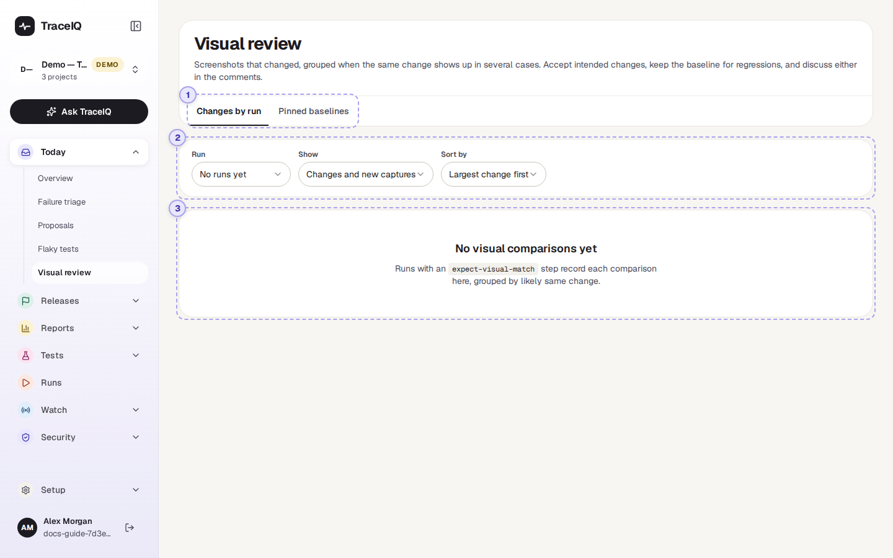
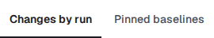
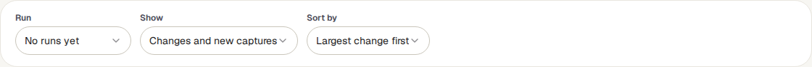
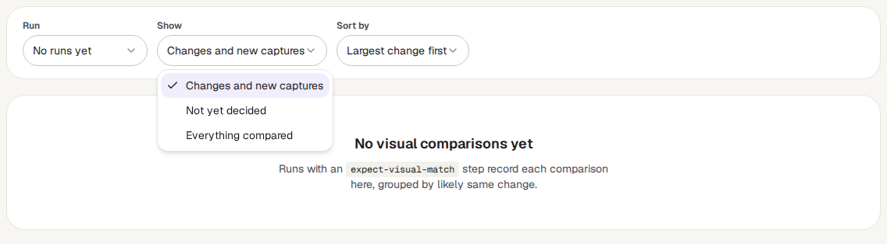
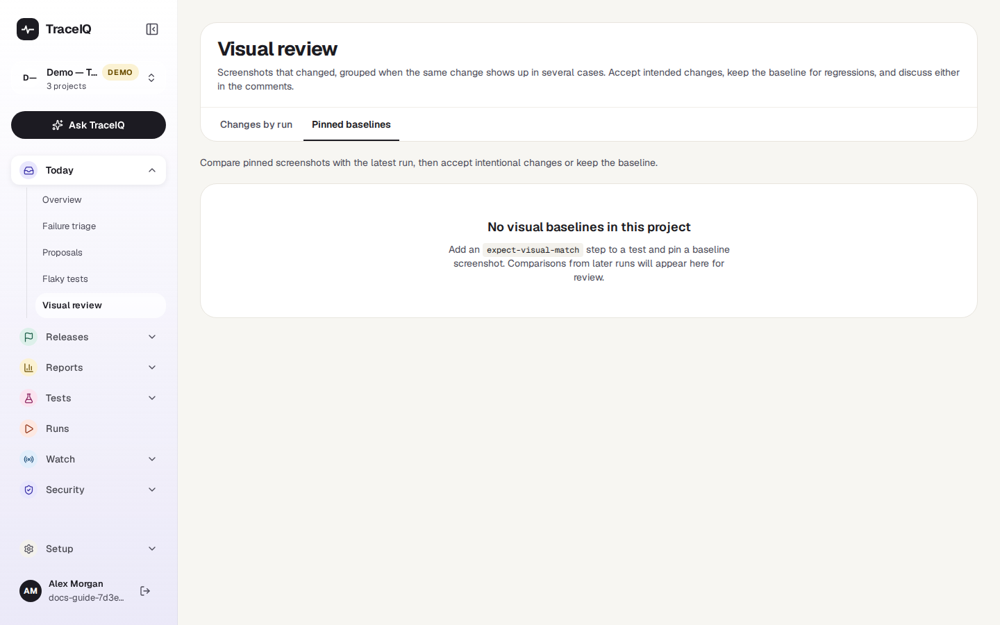

<!-- Generated from visual-review.html by e2e/docs-capture/export_md.py. Edit the HTML, not this file. -->

# Visual review

Today · Everyone with access to the project can see it · Editors decide and comment

> **In short**
>
> Some tests take a screenshot and compare it with an approved one. When the two differ, the change lands here. You look at the old and new picture side by side and decide: the change was intended (accept the new picture), or it is a mistake (keep the old one and fix the page).

## What it is for

Visual review answers **"Does the app still look the way it should?"** A test can check that a button exists without noticing that it is now white on white. A screenshot comparison catches that kind of change. This page is where a person decides whether each change is wanted.

> **Testers**
>
> Go through the screenshots that changed in the latest run and separate wanted changes from mistakes.

> **Designers and developers**
>
> Approve a new look in one go when the same change shows up on many pages.

> **Leads**
>
> See who approved which picture and when, and roll back an approval made by mistake.

**Where to find it:** in the sidebar, open **Today → Visual review**.

> **Three words used on this page**
>
> - The **baseline** is the approved screenshot: what the page should look like.
> - A **comparison** is one screenshot taken during a run, compared pixel by pixel with its baseline. It comes from a *Visual Match* step in a test, which photographs either the whole page or one element of it.
> - The **tolerance** is how much may differ before the step fails, as a share of the picture's pixels. It is 1% unless set otherwise.

## A tour of the screen

The page shows the project selected at the top of the sidebar. The numbers on the screenshot match the sections below. No test in the demo workspace takes screenshots, so its page is empty; what appears once there are comparisons is described under [③](#queue).

*The Visual review page in the demo workspace. Click the picture to see it larger.*

## 1. Two views

| Tab | What it shows |
|---|---|
| **Changes by run** | The screenshots taken during **one run**, with the changed ones first and related changes grouped. This is where you review. It opens first. |
| **Pinned baselines** | Every approved screenshot in the project, one at a time, with its history. Use it to look after a single baseline. See [Pinned baselines](#baselines). |

## 2. Run, Show and Sort by

| Control | What it does |
|---|---|
| **Run** | Which run to review. It lists the 20 most recent runs of the project that took screenshots, each with its date and how many screenshots changed. The newest is chosen when the page opens. On the right, a link opens that run's own page. |
| **Show** | *Changes and new captures* (the default): screenshots that differ from their baseline, plus first screenshots that have no baseline yet. *Not yet decided*: the same, minus those someone already accepted or kept. *Everything compared*: every screenshot of the run, unchanged ones included. |
| **Sort by** | *Largest change first* (by share of pixels changed), or *Case name*. |

## 3. The changes

With nothing to show you see *"No visual comparisons yet"* (no run of this project has taken a screenshot) or *"Nothing to review in this run"* (every screenshot was within its tolerance). Otherwise the list is on the left and what you pick is shown on the right.

### The list

- **"Same change in N cases"** boxes hold changes that look alike: the changed area has about the same size and looks the same before and after, in several tests of the run. A new banner or a changed font usually shows up like this. Press **Review group** to decide for all of them at once.
- **Changes** (or **Other changes**) holds the rest.
- Each row shows the test's name, whether it is the full page or an element, the step, the number of comments, the decision if there is one, and on the right the share of pixels that changed.
- The first group, or else the first change, is shown until you pick another.

### One change

At the top, labels say what you are looking at:

| Label | Meaning |
|---|---|
| Full page / Element | Whether the screenshot is of the whole page or of one part of it. |
| chromium | The browser (and device, if any) it was taken in. Each browser and device has its own baseline. |
| Over tolerance | More changed than allowed: the step failed, so the test failed. |
| Within tolerance | Something changed, but less than allowed. The test passed. |
| No baseline yet | The first screenshot of this step. There was nothing to compare with, and the step passed. |
| Changed 4.2% | The share of pixels that differ. |
| Size changed | The new screenshot is a different size from the baseline. |

Below them, three pictures side by side: **Baseline** (what it should look like), **Actual** (what this run saw) and **Difference** (the changed pixels highlighted). **Changed areas** lists the size and position of up to six changed regions. Then:

- **Accept new baseline** makes this run's screenshot the approved one. For a first screenshot the button says **Pin as first baseline**.
- **Keep baseline** leaves the approved screenshot as it is and records that you judged the change a mistake. Fix the page; the next run will compare again.
- **Comments on this change**: a short discussion thread, for example to ask the designer.

### A group of related changes

The group shows how many tests it covers, the largest change in it, and a small picture of each difference. Click a picture to open that change on its own. **Accept all in group** (it asks you to confirm) and **Keep all in group** decide for every member; each baseline still gets its own entry in its history. Members whose test has been deleted are skipped. A group has its own comment thread.

## Pinned baselines

*The Pinned baselines tab in the demo workspace: empty, because no screenshot has been approved.*

Every approved screenshot of the project, boxed by browser and device. Each row shows the test, full page or element, the step, when it was pinned, and its tolerance. The detail shows:

- The **latest capture**: the newest screenshot of that step among the test's 6 most recent runs, next to the baseline and the difference. If none of them took one, only the baseline is shown.
- **Accept new baseline** and **Keep baseline**, as above.
- **Decision history**: who accepted, kept or rolled back the baseline, and when. **Restore previous** puts back the picture a change replaced.
- **Delete baseline** (it asks you to confirm): later runs then have nothing to compare this step with, and its next screenshot counts as a first one.

## Watch it in use

[▶ Watch the video](../media/today/visual-review/walkthrough.mp4)

*Under a minute, with a spoken commentary. The captions at the bottom show the same words, so it also works with the sound off.*

## How to…

### …review the screenshots of the latest run

1. Make sure the right project is selected at the top of the sidebar. The newest run with screenshots is shown.
2. Set **Show** to *Not yet decided*, so you only see what still needs you.
3. Start with the groups: open one, look at two or three of its pictures, then **Accept all** or **Keep all**.
4. Go through the remaining changes one by one, comparing **Baseline** and **Actual**.

### …start comparing screenshots for a test

1. In the test editor (*Tests → Suites*), add a **Visual Match** step where the page looks the way it should. Give it a selector to photograph only one part of the page.
2. Run the test. The screenshot appears here as No baseline yet.
3. If it looks right, press **Pin as first baseline**. From the next run on, it is compared.

### …undo an approval made by mistake

1. Open the **Pinned baselines** tab and pick the baseline.
2. Press **Decision history**.
3. On the wrong approval, press **Restore previous**.

## Good to know

- **Who can do what.** Anyone with access to the project can look. Accepting, keeping, restoring, deleting and commenting need the *editor* role; people without it see a note instead of the buttons on both tabs.
- **Every decision is recorded**, including "keep", in the audit log, with who made it and for which run. The decision then shows on the change as Accepted or Kept baseline.
- **Grouping happens within one run.** The same change in two different runs is not grouped.
- **Accepting copies the picture.** The baseline keeps working after the run and its files are cleaned up.
- **Comments are plain text**, up to 4,000 characters. They can be marked resolved.
- **Not everything is listed under Changes by run.** Screenshot checks in mobile app tests don't report their comparisons there, nor do the check runs TraceIQ makes for a suggested fix (see *Proposals*).

## Related pages

> **Quality gate**
>
> The next part of this guide: the rules a release has to pass, such as "no failed tests".

> **Runs**
>
> Open the run a screenshot came from, with every step and its result.

> **Suites**
>
> Where tests are written, including the Visual Match step that takes the screenshots.

> **Frontend quality**
>
> Screen sizes and languages: screenshots of the same page at several widths, from one run.

## Video script

What the walkthrough says, in order. The video and every picture on this page are made by the Playwright script [`today-visual-review.spec.ts`](../../../../e2e/docs-capture/pages/today-visual-review.spec.ts).

1. Visual review is where you look at screenshots that changed.
2. A test can compare a screenshot of a page with an approved one, called the baseline.
3. Changes by run shows one run at a time. Pick the run here.
4. Show chooses what to list: changes, only the ones nobody decided yet, or everything.
5. Sort puts the biggest change first, or sorts by test name.
6. No test in the demo takes screenshots, so there is nothing to review yet.
7. Pinned baselines lists every approved screenshot in the project.
8. For each one you can accept the newest screenshot, keep the old one, or roll back.
