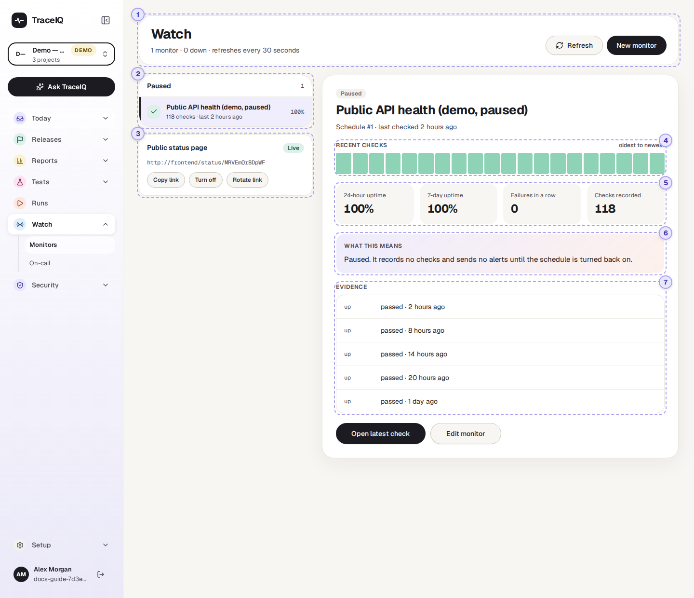
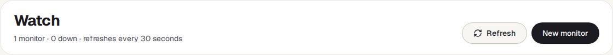
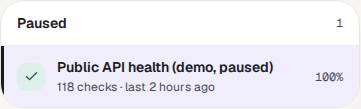
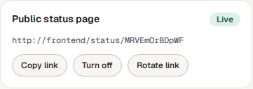
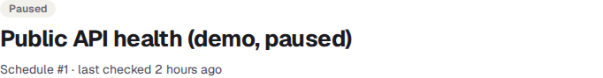
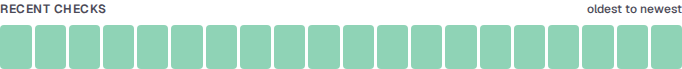
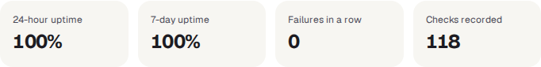
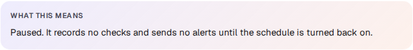
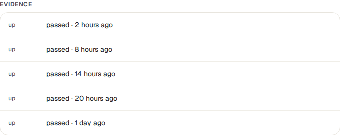

<!-- Generated from monitors.html by e2e/docs-capture/export_md.py. Edit the HTML, not this file. -->

# Monitors

Watch · Everyone with access to the project can see it · Project admins change monitors

> **In short**
>
> A monitor runs one of your tests on a timer, for example every five minutes, against the live site. This page shows whether each monitor is up or down, its recent checks and its uptime, and links to the run behind every check.

## What it is for

Monitors answer **"Is the live site working right now, and has it been working?"** Because every check is a real test (open the page, sign in, add an item…), a monitor notices a broken page or a failing sign-in, not only a server that doesn't answer. When a monitor goes down, TraceIQ can tell your team in Slack, Teams or by email, and page whoever is on call.

> **Operations and on-call**
>
> See at a glance what is down, since when, and open the failing check.

> **Testers**
>
> Tell an environment problem from a real bug: if the monitor was down too, the failed runs were probably the site, not the code.

> **Leads**
>
> Follow uptime over the last day and week, and share a public status page with customers.

**Where to find it:** in the sidebar, open **Watch → Monitors**. The page's own heading says **Watch**.

## A tour of the screen

The page shows the monitors of the project selected at the top of the sidebar. The list is on the left; the monitor you pick is shown in detail on the right. The numbers on the screenshot match the sections below.

*The Monitors page for the demo's Public API project, which has one monitor. It is paused, so it no longer checks. Click the picture to see it larger.*

## 1. The header

The line under the heading counts the project's monitors and how many are down. The page fetches new checks every 30 seconds by itself; **Refresh** fetches them now. **New monitor** opens the schedule form with *Run as a monitor* already ticked, because a monitor is a schedule with monitor mode switched on (see [How to set up a monitor](#how-to)). It is only shown to project admins.

## 2. The list of monitors

Monitors are boxed by state, the most urgent first:

| Box | What it holds |
|---|---|
| **Needs attention** | Monitors that are Down. |
| **Healthy** | Monitors that are Up. |
| **No checks yet** | New monitors waiting for their first check, which runs at the schedule's next time. |
| **Paused** | Monitors whose schedule is switched off. They record no checks and send no alerts. |

Each row shows the monitor's name, how many checks it has recorded, when the last one ran, and on the right its uptime over the last 24 hours. Click a row to show it on the right.

## 3. Public status page

A web page anyone with the link can open without signing in, for example your customers. It shows only the names of the project's monitors, whether each is up or down, and their uptime; never addresses, errors or run details.

- **Create page** makes the page and switches it on. Its address then appears on the card, with **Copy link**.
- **Turn off** / **Turn on** hides or shows it again under the same address.
- **Rotate link** gives the page a new address; the old link stops working.

These buttons save straight away and need the *editor* role. Viewers see only **Copy link** while the page is on.

## 4. Recent checks

At the top: the monitor's state, its name, its schedule number and when it last checked. A monitor that checks from several regions also shows one label per region, for example *eu · down (2 in a row)*.

One bar per check, for the latest 20, oldest on the left. Green means the check's test passed; orange means it didn't. Point at a bar to see its time and result.

## 5. The four numbers

| Number | What it means |
|---|---|
| **24-hour uptime** | The share of checks in the last 24 hours that passed. "—" when there were none. |
| **7-day uptime** | The same over the last 7 days. |
| **Failures in a row** | How many of the most recent checks failed one after the other (counted among the latest 20). 0 means the last check passed. |
| **Checks recorded** | Every check this monitor has ever recorded. |

Uptime counts checks, not minutes: a monitor that checks once an hour and fails once in a day shows about 96%, whatever the outage really lasted.

## 6. What this means

The state in plain words. For a healthy monitor that was up less than 99% of the last 7 days, it says so, because a wobbling site is worth a look before it becomes a release blocker.

## 7. Evidence

The 5 most recent checks, each with its result and time. Every check is a run, so **click one** to open its full result: the steps, the error and any screenshots. **Open latest check** does the same for the newest one, and **Edit monitor** (project admins only) opens the schedule form, where the monitor's timer, alert settings and regions are changed. Pausing it is done on the *Schedules* page.

## Watch it in use

[▶ Watch the video](../media/watch/monitors/walkthrough.mp4)

*Just under a minute, with a spoken commentary. The captions at the bottom show the same words, so it also works with the sound off.*

## How to…

### …set up a monitor

1. Press **New monitor**, pick the suite that checks the live site under **Suite to run**, and choose how often it runs.
2. Under **Run as a monitor** (already ticked), set how many failed checks in a row count as down (1 alerts on the first failure), whether to send a recovery alert, and who gets an email. Press **Create monitor**. An existing schedule becomes a monitor by ticking the same box in its form.
3. Come back here. The monitor waits under **No checks yet** until its first check.

### …find out why a monitor is down

1. Click the monitor in **Needs attention**.
2. Look at the bars: one orange bar at the end is a fresh problem; a long orange run means it has been down for a while.
3. Press **Open latest check** and read the failing step and its error.

### …give customers a status page

1. On the **Public status page** card, press **Create page**.
2. Press **Copy link** and share it.
3. If the link ends up somewhere it shouldn't, press **Rotate link** and share the new one.

## Good to know

- **When a monitor counts as down.** A check is up only when its test *passed*. The monitor turns Down once the number of failed checks in a row reaches the schedule's threshold; below that it keeps its previous state. A check that ran out of time counts as failed; a cancelled one doesn't count at all.
- **Alerts go out on the change, not on every check.** One message when it goes down (to the project's Slack or Teams channel, if notifications are on, and to the monitor's own email list), and one when it recovers, unless recovery alerts are switched off. Paging is set up on the *On-call* page.
- **Several regions.** A monitor can check from several places at once. Each region keeps its own streak and alerts; the monitor is Down if any region is down.
- **Checks are ordinary runs.** They also appear on the *Runs* page, started "by schedule".
- **The demo never alerts.** Its monitor is paused and its history was generated; no one is ever notified from a demo workspace.
- **Who can do what.** Anyone with access to the project can look. Creating or changing a monitor needs *project admin* (or workspace admin), like any schedule; the status page buttons need the *editor* role.

## Related pages

> **On-call**
>
> The next page in this guide: who gets paged when a monitor goes down, and quiet hours for maintenance.

> **Schedules**
>
> Where monitors are created and changed: the timer, the threshold, the alert emails and the regions.

> **SLOs**
>
> Uptime targets for a monitor and how much "error budget" is left.

> **Runs**
>
> Every check's full result, with steps, errors and screenshots.

## Video script

What the walkthrough says, in order. The video and every picture on this page are made by the Playwright script [`watch-monitors.spec.ts`](../../../../e2e/docs-capture/pages/watch-monitors.spec.ts).

1. Monitors run a test on a timer against your live site, and tell you when it goes down.
2. Monitors belong to a project. The demo monitor is in the Public API project.
3. The list groups monitors: down first, then healthy, waiting for a first check, and paused.
4. This one is paused, so it records no checks and sends no alerts.
5. Each bar is one check, oldest on the left. Green means the test passed.
6. Uptime over the last day and week, and how many checks failed in a row.
7. Each check is a real test run. Click one to open its result.
8. Edit monitor opens its schedule form, where its timer and alerts can be changed.
9. A project can also have a public status page, built from its monitors.
