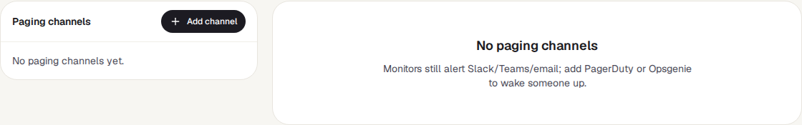
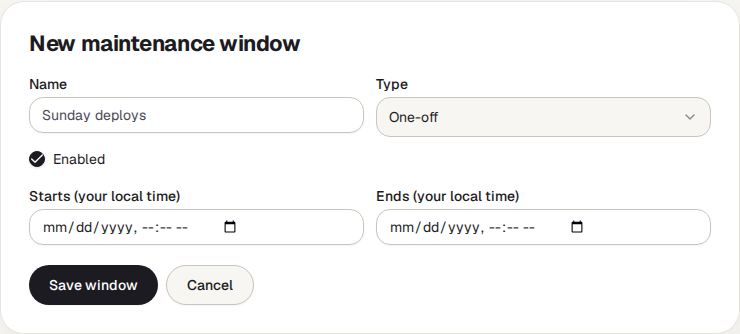
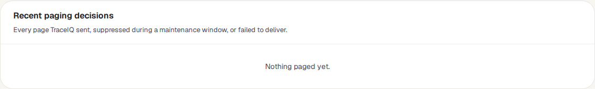

<!-- Generated from on-call.html by e2e/docs-capture/export_md.py. Edit the HTML, not this file. -->

# On-call

Watch · Everyone with access to the project can see it · Project admins can change it

> **In short**
>
> Who gets woken up, and when not. Here you connect a project to PagerDuty or Opsgenie so that a monitor going down pages whoever is on call, set quiet hours for planned maintenance, see every paging decision TraceIQ made, and limit which websites the project's test browsers may reach.

## What it is for

On-call answers **"If the live site breaks at 3 a.m., will the right person hear about it, and will nobody be woken for a planned outage?"** A Slack message is easy to miss at night. PagerDuty and Opsgenie are services that phone or text the person on duty. TraceIQ opens an incident there when something breaks and closes it again when it recovers.

> **Operations**
>
> Connect the project to the on-call service, and test that the connection works.

> **Release managers**
>
> Set a maintenance window for a planned deploy, so nobody is paged for it.

> **Security and leads**
>
> Check why someone was, or wasn't, paged, and keep test browsers away from sites they shouldn't touch.

**Where to find it:** in the sidebar, open **Watch → On-call**.

## A tour of the screen

The page always shows the project selected at the top of the sidebar; pick another project there and the page follows. (With no project selected it asks you to pick one.) Under the heading are four tabs, and only the open tab's contents are shown. The page opens on **Paging channels**. The numbers on the screenshot match the sections below. The demo workspace has no paging set up (a demo never pages anyone), so its tabs are empty.

*The On-call page for the demo's web project, on the Paging channels tab. Click the picture to see it larger.*

## 1. Tabs

| Tab | What it is for |
|---|---|
| **Paging channels** | The connections to PagerDuty or Opsgenie (parts ② and ③). |
| **Maintenance windows** | Times when nobody should be paged. |
| **Paging log** | Every paging decision TraceIQ made. |
| **Egress allowlist** | Which websites the project's test browsers may reach. |

The last three are described under [The other tabs](#other-tabs) below.

## 2. Paging channels

A **channel** is one connection to PagerDuty or Opsgenie. A project can have several, for example one per team. The list on the left shows each channel's name, its service (and Opsgenie region), its severity and whether a key is set, with a Error label if its last page failed, or disabled if it is switched off. Click a channel to show it on the right; the first one is shown when the tab opens.

## 3. A channel, or the form

The right-hand side shows the channel picked in the list: an Enabled or Disabled label, the service, the name, and three buttons.

- **Send test page** opens a test incident ("TraceIQ test page — safe to ignore") and closes it again at once, so you know the key works.
- **Edit** opens the channel in the form below.
- **Delete** asks you to confirm, then removes the channel.

Under the buttons: the **Service**, **Severity**, whether a **Key** is set, what it **Pages on** (monitors, run failures, or nothing) and when it **Last sent** something. If sending failed, a **Last error** box gives the reason.

**Add channel** (top of the list) shows this form on the right instead:

| Field | What to fill in |
|---|---|
| **Name** | Anything that tells people which channel it is, e.g. "Checkout on-call". |
| **Service** | PagerDuty or Opsgenie. For Opsgenie, also choose its **region** (US or EU), the one your Opsgenie account is in. |
| **Routing key / API key** | The key from PagerDuty or Opsgenie that lets TraceIQ open incidents. It is stored encrypted and never shown again; when editing, leave it empty to keep it. |
| **Severity** | How urgent the incidents are: critical, error, warning or info (in Opsgenie, priority P1 to P4). |
| **Page on monitor DOWN** | On by default. Opens an incident when a monitor goes down and closes it when the monitor recovers. |
| **Page on failed scheduled / CI runs** | Off by default. Opens an incident when a run started by a schedule, by your build pipeline (CI) or by a webhook fails, and closes it when the next run of the same suite or test passes. |
| **Enabled** | Untick to stop a channel paging without deleting it. |

**Add channel** (or **Save channel** when editing) saves it; **Cancel** goes back to the channel you had picked.

## The other tabs

### Maintenance windows

A **maintenance window** is a time when TraceIQ must not page anyone, such as a planned deploy. During a window, pages are held back but still recorded in the **Paging log**, so you can see what would have happened. Slack, Teams and email alerts still go out.

The tab works like the channels tab: a list on the left (each window's name and when it applies, with active now while it is in force, or disabled), and on the right the window you picked, with **Edit** and **Delete** buttons and its days and times. **Add window** shows this form on the right:

- **One-off**: a start and an end, typed in your own local time.
- **Weekly recurring**: the days of the week, a from and until time, and a time zone (for example `Europe/Berlin`; it starts as your browser's). An end earlier than the start runs past midnight, e.g. Friday 22:00 to Saturday 06:00.
- **Enabled**: untick to keep a window without it holding anything back.

### Paging log

Under the heading **Recent paging decisions**: the 50 newest decisions, one row per channel, newest first.

| Column | What it shows |
|---|---|
| **When** | The date and time, in your local time. |
| **Source** | *monitor* or *run*, with the run number. |
| **Action** | *trigger* (open an incident) or *resolve* (close it). |
| **Dedup key** | The name the incident goes by in PagerDuty or Opsgenie. A monitor that stays down keeps the same key, so it adds to one incident instead of opening a new one each time. |
| **Outcome** | sent, suppressed (held back by a maintenance window, which is named), or failed (with the reason, e.g. a wrong key). |

### Egress allowlist

This tab (headed **Worker egress allowlist**) is about the *test browsers*, not about paging. When it is enforced, the browser that runs this project's tests may only open the listed websites (and their sub-addresses: `example.com` also allows `shop.example.com`). Anything else is blocked, and shows up as a blocked request in the run's network details. This keeps tests from reaching, for example, a live payment provider.

- **Enforce for this project** switches the list on.
- **Allow private / internal addresses** lets tests reach machines inside your own network. A server administrator can forbid that for everyone; the right-hand side then says it is capped.
- **Allowed hosts**: one website per line. **Save egress policy** saves the three settings.
- **Effective at dispatch**, on the right, shows what the next run will actually use. The address of the environment a test runs against is always allowed, and the special addresses cloud servers use for their own settings are always blocked. A server administrator can also enforce the list for every project.

> **Enforced with no hosts blocks everything**
>
> If the list is enforced and empty (apart from the environment's own address), every other request of the test browser is blocked. Live connections such as WebSockets are not checked by the list.

## Watch it in use

[▶ Watch the video](../media/watch/on-call/walkthrough.mp4)

*Under a minute, with a spoken commentary. The captions at the bottom show the same words, so it also works with the sound off.*

## How to…

### …page the on-call person when a monitor goes down

1. In PagerDuty (or Opsgenie), create an integration for TraceIQ and copy its routing key (or API key).
2. Here, on the **Paging channels** tab, check that the sidebar shows the right project, press **Add channel**, give it a name, choose the service and paste the key. Leave **Page on monitor DOWN** ticked.
3. Press **Add channel** to save it. Click the new channel in the list, then press **Send test page**. A test incident should appear and close in PagerDuty or Opsgenie.

### …stop pages during a planned deploy

1. Open the **Maintenance windows** tab, press **Add window** and give it a name, e.g. "Release 4.2".
2. Keep **One-off** and type the start and end in your own time. For a regular slot, choose **Weekly recurring** instead.
3. Press **Save window**. During it, decisions show as *suppressed* on the **Paging log** tab.

### …find out why someone was, or wasn't, paged

1. Open the **Paging log** tab and find the time in question.
2. *suppressed* names the maintenance window that held it back; *failed* gives the error from PagerDuty or Opsgenie.
3. No row at all means nothing asked to page: check that the channel is enabled and set to page on monitors or runs.

## Good to know

- **Who can do what.** Anyone with access to the project can look. Adding, editing, testing and deleting channels and windows, and saving the egress list, need the project's *admin* role (editor is not enough), because they decide who is woken up and what tests can reach. Every change is written to the audit log.
- **Which runs page.** Only runs started by a schedule, by CI or by a webhook. Runs started by a person, by an AI agent or on a developer's own computer never page; nor does a cancelled run. A run that hits TraceIQ's time limit pages like a failure. A monitor's checks page through the monitor setting, not this one.
- **Recovery closes the same incident.** When the monitor recovers, or the next run passes, TraceIQ closes exactly the incident it opened. If the page was held back by a maintenance window, nothing is closed, because nothing was opened.
- **Pages go out on the change.** A monitor pages once when it goes down, not on every failed check.
- **Keys stay secret.** A saved key is never shown again or written to the paging log.
- **It updates by itself.** The decisions refresh every 30 seconds and the windows every minute.

## Related pages

> **Monitors**
>
> The tests on a timer whose ups and downs page the on-call person.

> **Scans & findings**
>
> The next part of this guide: security scans of your app and what they found.

> **Schedules**
>
> The timers behind monitors and scheduled runs.

> **Audit log**
>
> Who changed a channel, a window or the egress list, and when.

## Video script

What the walkthrough says, in order. The video and every picture on this page are made by the Playwright script [`watch-on-call.spec.ts`](../../../../e2e/docs-capture/pages/watch-on-call.spec.ts).

1. On-call decides who gets woken up when a monitor goes down, and when nobody should be.
2. It works on the project chosen in the sidebar, in four tabs.
3. A paging channel sends an alert to PagerDuty or Opsgenie. The demo has none.
4. Adding one opens a form on the right: a name, the service, its key, and what should page.
5. We cancel here, so nothing is saved.
6. A maintenance window holds pages back, for example during a planned deploy.
7. The paging log lists every paging decision: sent, held back, or failed.
8. Last, the egress allowlist limits which websites this project's test browsers may reach.
9. Here it is not enforced, so tests can reach any site.
