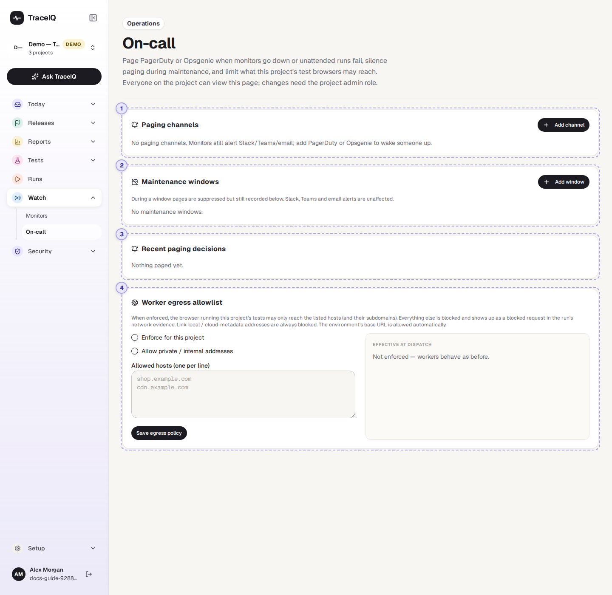
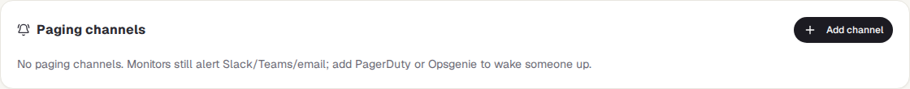
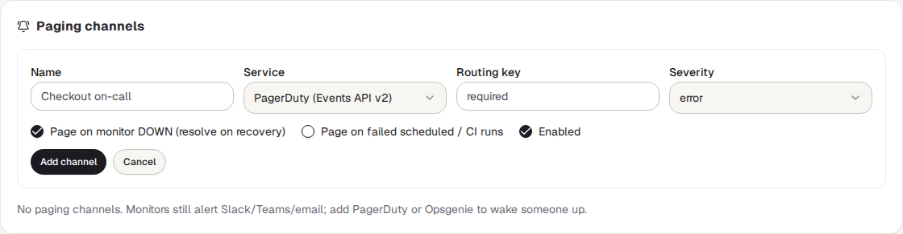
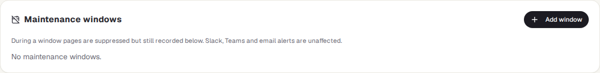
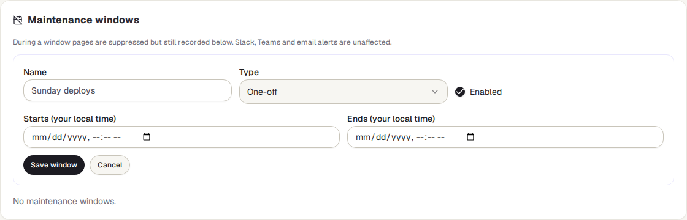
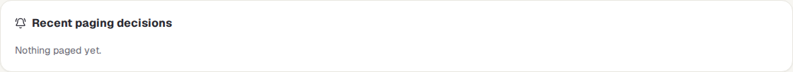
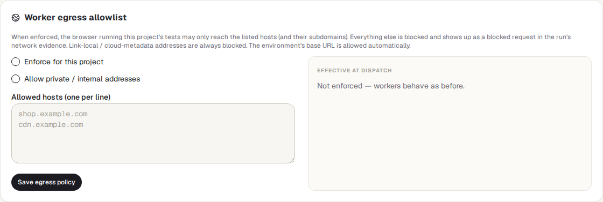

<!-- Generated from on-call.html by e2e/docs-capture/export_md.py. Edit the HTML, not this file. -->

# On-call

Watch · Everyone with access to the project can see it · Project admins can change it

> **In short**
>
> Who gets woken up, and when not. Here you connect a project to PagerDuty or Opsgenie so that a monitor going down pages whoever is on call, set quiet hours for planned maintenance, see every paging decision TraceIQ made, and limit which websites the project's test browsers may reach.

## What it is for

On-call answers **"If the live site breaks at 3 a.m., will the right person hear about it, and will nobody be woken for a planned outage?"** A Slack message is easy to miss at night. PagerDuty and Opsgenie are services that phone or text the person on duty. TraceIQ opens an incident there when something breaks and closes it again when it recovers.

> **Operations**
>
> Connect the project to the on-call service, and test that the connection works.

> **Release managers**
>
> Set a maintenance window for a planned deploy, so nobody is paged for it.

> **Security and leads**
>
> Check why someone was, or wasn't, paged, and keep test browsers away from sites they shouldn't touch.

**Where to find it:** in the sidebar, open **Watch → On-call**.

## A tour of the screen

The page shows the project selected at the top of the sidebar, in four cards. The numbers on the screenshot match the sections below. The demo workspace has no paging set up (a demo never pages anyone), so its cards are empty.

*The On-call page for the demo's web project. Click the picture to see it larger.*

## 1. Paging channels

A **channel** is one connection to PagerDuty or Opsgenie. A project can have several, for example one per team. **Add channel** opens this form:

| Field | What to fill in |
|---|---|
| **Name** | Anything that tells people which channel it is, e.g. "Checkout on-call". |
| **Service** | PagerDuty or Opsgenie. For Opsgenie, also choose its **region** (US or EU), the one your Opsgenie account is in. |
| **Routing key / API key** | The key from PagerDuty or Opsgenie that lets TraceIQ open incidents. It is stored encrypted and never shown again; when editing, leave it empty to keep it. |
| **Severity** | How urgent the incidents are: critical, error, warning or info (in Opsgenie, priority P1 to P4). |
| **Page on monitor DOWN** | On by default. Opens an incident when a monitor goes down and closes it when the monitor recovers. |
| **Page on failed scheduled / CI runs** | Off by default. Opens an incident when a run started by a schedule, by your build pipeline (CI) or by a webhook fails, and closes it when the next run of the same suite or test passes. |
| **Enabled** | Untick to stop a channel paging without deleting it. |

Once there are channels, a table lists each one: what it pages on, when it last sent something (and the last error, if sending failed), and three buttons. **Test** opens a test incident ("TraceIQ test page — safe to ignore") and closes it again at once, so you know the key works. **Edit** and **Delete** do what they say.

## 2. Maintenance windows

A **maintenance window** is a time when TraceIQ must not page anyone, such as a planned deploy. During a window, pages are held back but still written to the list below, so you can see what would have happened. Slack, Teams and email alerts still go out.

- **One-off**: a start and an end, typed in your own local time.
- **Weekly recurring**: the days of the week, a from and until time, and a time zone (for example `Europe/Berlin`; it starts as your browser's). An end earlier than the start runs past midnight, e.g. Friday 22:00 to Saturday 06:00.
- A window that is in force right now is marked **active now**.

## 3. Recent paging decisions

The 50 newest decisions, one row per channel, newest first:

| Column | What it shows |
|---|---|
| **When** | The date and time, in your local time. |
| **Source** | *monitor* or *run*, with the run number. |
| **Action** | *trigger* (open an incident) or *resolve* (close it). |
| **Dedup key** | The name the incident goes by in PagerDuty or Opsgenie. A monitor that stays down keeps the same key, so it adds to one incident instead of opening a new one each time. |
| **Outcome** | **sent**, **suppressed** (held back by a maintenance window, which is named), or **failed** (with the reason, e.g. a wrong key). |

## 4. Worker egress allowlist

This card is about the *test browsers*, not about paging. When it is enforced, the browser that runs this project's tests may only open the listed websites (and their sub-addresses: `example.com` also allows `shop.example.com`). Anything else is blocked, and shows up as a blocked request in the run's network details. This keeps tests from reaching, for example, a live payment provider.

- **Enforce for this project** switches the list on.
- **Allow private / internal addresses** lets tests reach machines inside your own network. A server administrator can forbid that for everyone; the right-hand side then says it is capped.
- **Allowed hosts**: one website per line.
- **Effective at dispatch**, on the right, shows what the next run will actually use. The address of the environment a test runs against is always allowed, and the special addresses cloud servers use for their own settings are always blocked. A server administrator can also enforce the list for every project.

> **Enforced with no hosts blocks everything**
>
> If the list is enforced and empty (apart from the environment's own address), every other request of the test browser is blocked. Live connections such as WebSockets are not checked by the list.

## Watch it in use

[▶ Watch the video](../media/watch/on-call/walkthrough.mp4)

*Under a minute, with a spoken commentary. The captions at the bottom show the same words, so it also works with the sound off.*

## How to…

### …page the on-call person when a monitor goes down

1. In PagerDuty (or Opsgenie), create an integration for TraceIQ and copy its routing key (or API key).
2. Here, press **Add channel**, give it a name, choose the service and paste the key. Leave **Page on monitor DOWN** ticked.
3. Press **Add channel**, then **Test** on its row. A test incident should appear and close in PagerDuty or Opsgenie.

### …stop pages during a planned deploy

1. Press **Add window** and give it a name, e.g. "Release 4.2".
2. Keep **One-off** and type the start and end in your own time. For a regular slot, choose **Weekly recurring** instead.
3. Press **Save window**. During it, decisions show as *suppressed* in the list below.

### …find out why someone was, or wasn't, paged

1. Look at **Recent paging decisions** for the time in question.
2. *suppressed* names the maintenance window that held it back; *failed* gives the error from PagerDuty or Opsgenie.
3. No row at all means nothing asked to page: check that the channel is enabled and set to page on monitors or runs.

## Good to know

- **Who can do what.** Anyone with access to the project can look. Adding, editing, testing and deleting channels and windows, and saving the egress list, need the project's *admin* role (editor is not enough), because they decide who is woken up and what tests can reach. Every change is written to the audit log.
- **Which runs page.** Only runs started by a schedule, by CI or by a webhook. Runs started by a person, by an AI agent or on a developer's own computer never page; nor does a cancelled run. A run that hits TraceIQ's time limit pages like a failure. A monitor's checks page through the monitor setting, not this one.
- **Recovery closes the same incident.** When the monitor recovers, or the next run passes, TraceIQ closes exactly the incident it opened. If the page was held back by a maintenance window, nothing is closed, because nothing was opened.
- **Pages go out on the change.** A monitor pages once when it goes down, not on every failed check.
- **Keys stay secret.** A saved key is never shown again or written to the decision list.
- **It updates by itself.** The decisions refresh every 30 seconds and the windows every minute.

## Related pages

> **Monitors**
>
> The tests on a timer whose ups and downs page the on-call person.

> **Scans & findings**
>
> The next part of this guide: security scans of your app and what they found.

> **Schedules**
>
> The timers behind monitors and scheduled runs.

> **Audit log**
>
> Who changed a channel, a window or the egress list, and when.

## Video script

What the walkthrough says, in order. The video and every picture on this page are made by the Playwright script [`watch-on-call.spec.ts`](../../../../e2e/docs-capture/pages/watch-on-call.spec.ts).

1. On-call decides who gets woken up when a monitor goes down, and when nobody should be.
2. A paging channel sends an alert to PagerDuty or Opsgenie. The demo has none.
3. Adding one asks for a name, the service, its key, and what should page.
4. We cancel here, so nothing is saved.
5. A maintenance window holds pages back, for example during a planned deploy.
6. Every paging decision is listed here: sent, held back, or failed.
7. Last, the egress allowlist limits which websites this project's test browsers may reach.
8. Here it is not enforced, so tests can reach any site.
